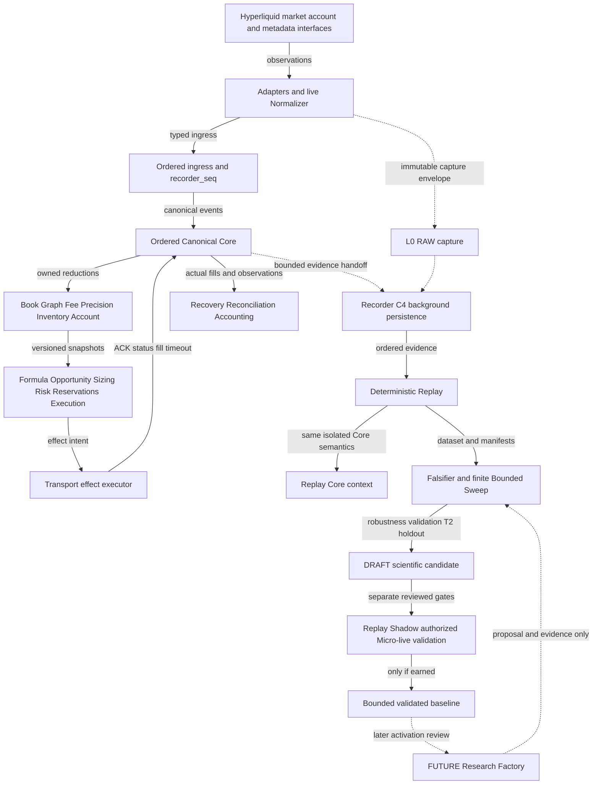
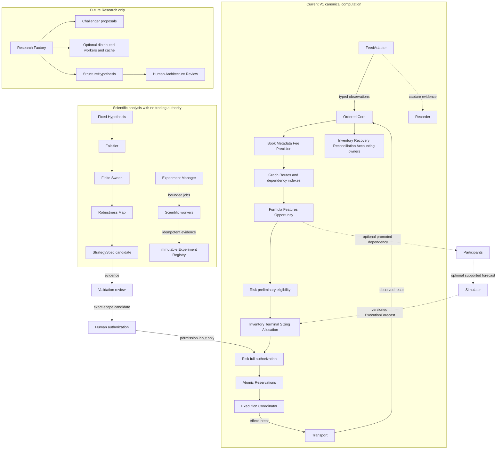
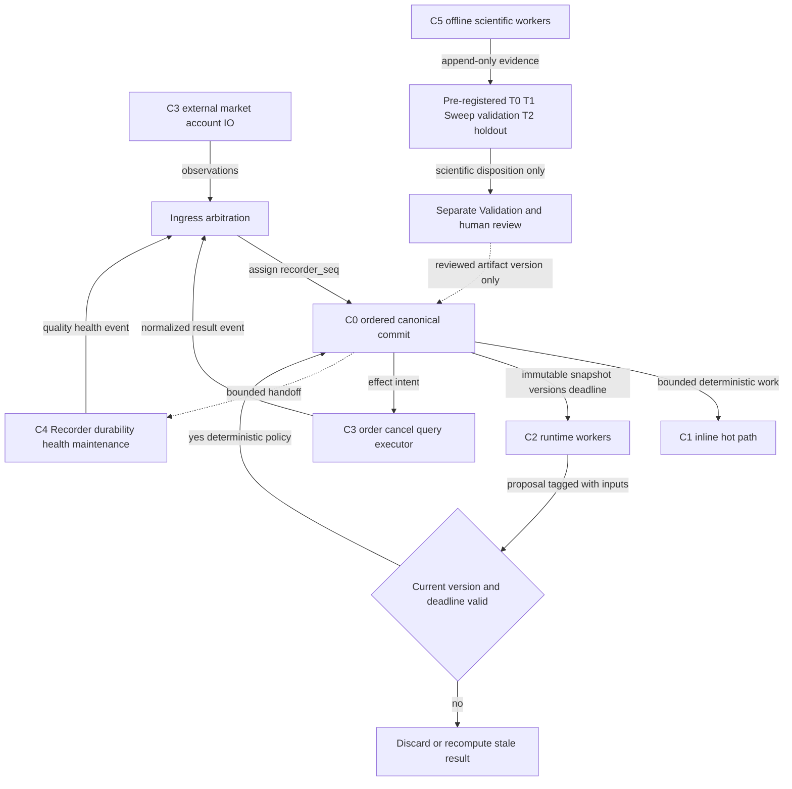
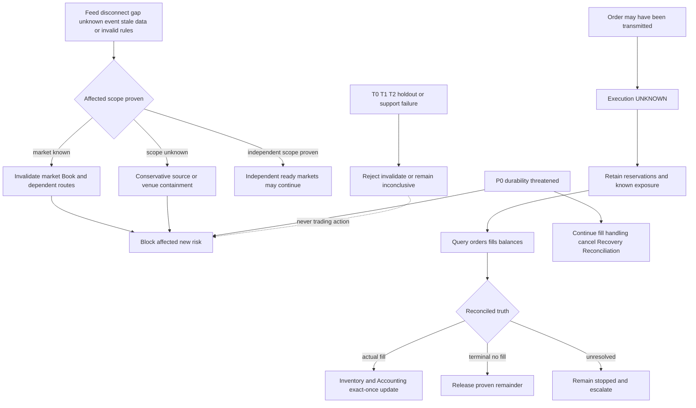
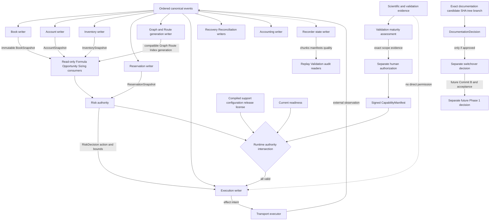

# F2 Architecture Diagram Atlas

`DOCUMENTATION STATUS: PROPOSED F2 NAVIGATION — AWAITING HUMAN REVIEW`

Authority level: L3 pedagogical navigation. These maps explain existing and proposed documentary
contracts. They are not generated-code diagrams, implementation evidence, capability activation or
capital authorization. Function-level and worked operational drill-downs are maintained in the
[Architecture Visual Atlas](../../deep-specs/architecture/15_ARCHITECTURE_VISUAL_ATLAS.md); owning
Masters and deep specs remain authoritative when a diagram is simplified.

### Atlas authority boundary

This file owns only the five-map **F2 review-snapshot presentation** required for the exact F2
candidate. It is corrected here so the snapshot does not preserve misleading arrows, but it is not
the evolving catalog for future diagrams. New cross-domain diagrams and later operational
walkthroughs receive stable `ARCH-MAP-*` identities only in the maintained Architecture Visual
Atlas. Neither atlas owns domain semantics: the named Master/deep contract remains authoritative.
Once an exact corrected F2 snapshot is selected, later atlas evolution does not silently rewrite
that historical review subject; a material change creates a new candidate/delta review.

## Map 1 — Global architecture and first-baseline boundary

| Required field | Map-1 meaning |
|---|---|
| Inputs | point-in-time market/account facts, rules, fixed hypothesis, frozen protocol |
| Operations | canonical reduction/economics; Replay/Simulator; falsification; separate capability validation |
| Outputs | immutable evidence, diagnostic region/disposition, possible DRAFT candidate, later bounded baseline |
| Canonical owner | domain Masters for truth; Validation for evidence; human/authorization records for permission |
| Dependencies | phases 1–20 as applicable; M0–M4 evidence; readiness, Risk and exact manifest |
| Failure / STOP | stale/unknown truth, invalid q, leakage, failed holdout, unmet maturity or missing authorization |
| Status | first path specified but unimplemented/unauthorized; Factory future and inactive |
| Related findings / scenarios | ARCH-001–005, ARCH-010, ARCH-018–020; A-03, A-08–A-16, A-24 |
| Drill-down | `ARCH-MAP-001`, `003`, `008`, `010` in the maintained visual atlas |

The first DRAFT candidate and its separately gated validation path do not depend on activating the
Factory. Conversely, no scientific result skips a technical dependency or permission gate.

## Map 2 — Functional ownership map

| Required field | Map-2 meaning |
|---|---|
| Inputs | exchange facts, immutable snapshots, canonical versions, hypothesis/protocol |
| Operations | truth reconstruction, economics, scenario evaluation, deterministic job execution, indexing/presentation |
| Outputs | canonical state, proposals, reports and evidence links; workers/dashboard never output permission |
| Canonical owner | Adapter/Data/Formula/Execution/Risk owners for facts; Research only for protocols/orchestration |
| Dependencies | each analyzer inherits every canonical engine and evidence dependency it consumes |
| Failure / STOP | invented data/fills, mutable registry, stale worker result, coordinator treated as truth, authority leakage |
| Status | Core contracts canonical; Falsifier/Registry specified; Manager/workers unimplemented; Factory/distribution future |
| Related findings / scenarios | ARCH-002, ARCH-005–008, ARCH-010, ARCH-012, ARCH-023–028; A-01–A-08, A-11–A-14, A-18–A-23 |
| Drill-down | `ARCH-MAP-002`, `009`, `011`, `012`, `013` in the maintained visual atlas |

DragonflyDB, if ever selected, may hold transient research queue/lease/cache/progress state only.
It cannot hold canonical Inventory, ESM, Risk, Recovery, Reconciliation, capital, signer/nonce or
Live configuration truth.

## Map 3 — Temporal runtime and experiment boundaries

| Required field | Map-3 meaning |
|---|---|
| Inputs | concurrent observations; immutable runtime snapshots; pre-registered scientific datasets/protocols |
| Operations | ingress sequencing; ordered commits; bounded runtime proposals; async effects/durability; isolated scientific work |
| Outputs | canonical versions, accepted/rejected proposals, effect observations and append-only scientific evidence |
| Canonical owner | ordered domain reducers for runtime; Validation/Data for scientific evidence; no worker owns economic truth |
| Dependencies | versioned ingress policy, bounded queues/deadlines, current-version revalidation, no-lookahead experiment protocol |
| Failure / STOP | C2 completion order cannot decide; stale results drop; C4 cannot block indefinitely; C5 cannot mutate Live state |
| Status | C0–C5 semantics documented; queue sizes, ingress tie policy and fanout policy require evidence/decision |
| Related findings / scenarios | ARCH-003, ARCH-010, ARCH-011, ARCH-016, ARCH-018–021; A-03, A-07, A-09, A-15–A-17, A-20 |
| Drill-down | `ARCH-MAP-003`, `008`, `010` in the maintained visual atlas |

`ROBUST_CANDIDATE` is not `SHADOW_CANDIDATE`, M3, a Strategy promotion or capital permission.

## Map 4 — Risks and failure containment

| Required field | Map-4 meaning |
|---|---|
| Inputs | data/rules/q, experimental cells, actual order/fill events, worker/registry/coordinator health |
| Operations | fail-closed validation, scope containment, reconciliation, evidence invalidation and safe demotion |
| Outputs | rejected/invalid scientific claim, locked reservation, current exposure, incident/evidence records |
| Canonical owner | Data/Formula/Validation for scientific validity; Execution/Risk/Reconciliation for trading safety |
| Dependencies | exact provenance, current versions, unique fills, bounded jobs, durable evidence and stop rules |
| Failure / STOP | unresolved ownership/account truth broadens STOP; research failure never triggers a trading action |
| Status | failure rules specified; no runtime implementation or passed drill claimed |
| Related findings / scenarios | ARCH-009, ARCH-013–017, ARCH-019–021, ARCH-025–029; A-01, A-05, A-07, A-11, A-15–A-19, A-24 |
| Drill-down | `ARCH-MAP-004`, `006`–`009`, `012`, `013` in the maintained visual atlas |

Scientific rejection answers whether a claim survives evidence. Trading safety answers what may
happen to real state. A rejected cell cannot directly cancel an order; a worker success cannot
unlock a reservation.

## Map 5 — State ownership, evidence and authorization

| Required field | Map-5 meaning |
|---|---|
| Inputs | provenance-typed evidence, current earned maturity and a proposed next scoped activity; exact candidate commit/tree/branch in external records |
| Operations | immutable indexing; Validation assesses current earned maturity; exact prerequisites and separate prior authorization are checked for the proposed activity; only the authorized scope executes; new evidence returns to Validation review |
| Outputs | evidence disposition or decision record; never implicit next-gate approval |
| Canonical owner | Data/Registry for evidence lineage; Validation for maturity; named human authority for decisions; Risk at runtime |
| Dependencies | complete exact snapshot, current evidence, applicable SI set, traceability and non-stale prerequisites; exact CapabilityManifest, readiness, Risk and applicable capital/order authorization before any capital/order effect |
| Failure / STOP | mixed evidence classes, moving-HEAD identity, stale certificate, approve-with-changes, failed prerequisite, denied authorization or activity outside the authorized scope |
| Status | proposed F2 review package pending; no documentation approval, switchover, B, Phase 1 or capital authority |
| Related findings / scenarios | ARCH-006, ARCH-012, ARCH-024–029; A-02, A-04, A-05, A-10–A-12, A-18, A-23, A-24 |
| Drill-down | `ARCH-MAP-002`, `005`, `009`, `010`, `011`, `013` in the maintained visual atlas |

Maturity records evidence already earned; authorization permits only a separately reviewed future
scope. The following rules therefore apply:

- M0 is documentation maturity, not execution permission.
- M1/M2 evidence does not automatically authorize Shadow.
- Shadow requires prior authorization; successful evidence may subsequently establish M3.
- Micro-live requires separate prior authorization and applicable capital controls; successful
  evidence may establish M4.
- Live requires its own prior authorization; M5 is earned only from valid scoped Live evidence.
- Every capital/order effect requires the exact CapabilityManifest, readiness, Risk and applicable
  capital/order authorization.
- A failed prerequisite or denied authorization prevents the next risk-increasing activity.
- Existing exposure remains governed by canonical Risk, Recovery and Reconciliation.
- No stage promotes itself or another stage.

The final F2 commit SHA/tree are deliberately absent from its own corpus. A reviewer records them
externally after the commit exists. Any material post-selection change creates another candidate
and restarts exact-snapshot review.

## Specialized map links

- [First baseline and later Challenger lineage](../../deep-specs/strategy-research/03_STRATEGY_SPEC_AND_LINEAGE.md#d1--first-owatt-baseline-path-and-later-challengers)
- [Falsifier end-to-end architecture](../../deep-specs/validation/13_ECONOMIC_FALSIFIER_AND_BOUNDED_SWEEP.md)
- [Robust region lifecycle](../../deep-specs/validation/14_ROBUST_REGION_AND_CANDIDATE_LIFECYCLE.md)
- [Research orchestration and workers](../../deep-specs/strategy-research/11_RESEARCH_ORCHESTRATION_AND_WORKERS.md)
- [Experiment Registry and Analytics](../../deep-specs/strategy-research/09_REPORTING_AND_KNOWLEDGE_BASE.md)
