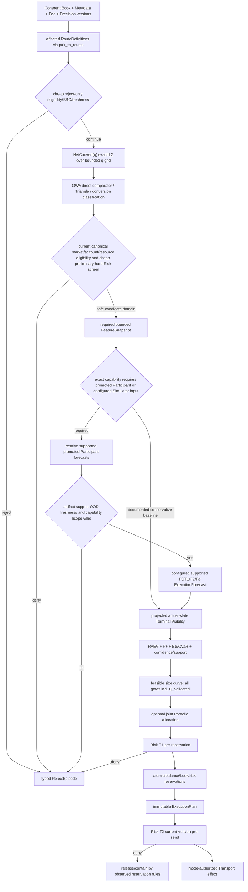

# Decision Pipeline Map

`DOCUMENTATION STATUS: AWAITING HUMAN REVIEW`

Data interfaces: `BookSnapshot`/rule snapshots → `RouteEconomics` → Opportunity/RejectEpisode → Feature/Model forecasts → `ExecutionForecast` → viability/size/allocation proposal → `RiskDecision` → `ReservationState` → `ExecutionPlan`.

Ordering resolution: Risk is staged, not a single terminal function. Current canonical eligibility
and the constitutional/cheap screen happen before an expensive optional model invocation becomes a
required predecessor. Required bounded features may be incrementally available and independent
pure calculations may overlap; the diagram fixes dependencies and authorization, not one synchronous
scheduler. A capability that requires an unavailable/unsupported model rejects, while the documented
conservative baseline follows its own support envelope. Exact candidate/tail/size checks happen
before reservation; the immutable plan follows the committed claims; T2 is immediate pre-send;
T3–T5 revalidate after fills, before later legs and while a maker order rests. No later stage can
restore an action removed from `A_safe`.

Basic Opportunity + conservative models/F0/F1 + zero/limited q are final-interface-compatible bootstrap baselines.
