# Architecture Visual Atlas

`DOCUMENTATION STATUS: AWAITING HUMAN REVIEW`

This atlas is the maintained visual entry point for understanding how the system is intended to
work across domain, temporal, failure, evidence and operational boundaries. It supplements the
[Master Architecture](../../00_MASTER_ARCHITECTURE.md) and the owning domain contracts; it never
overrides them.

The diagrams describe documentary contracts. They are not implementation evidence, passed tests,
capability activation, Live permission or capital authorization.

## Atlas authority boundary

This is the sole **maintained cross-domain visual catalog**. It owns stable `ARCH-MAP-*`
identifiers, navigation and current explanatory renderings, but never the underlying domain
semantics. Masters and owning deep contracts remain authoritative. The F2 five-map atlas is a
candidate-specific review snapshot: it may link here for drill-down, but future diagrams are not
duplicated there and changes here do not retroactively certify or rewrite a selected F2 snapshot.

## 1. How to extend this atlas

Future architecture diagrams belong here when they explain a cross-domain flow or provide a
navigation view that is useful beyond one analysis pass.

1. Give each diagram a stable `ARCH-MAP-NNN` identifier and never renumber an existing map.
2. Add it to the catalog before adding the Mermaid source.
3. State its inputs, outputs, owner, dependencies, exceptional paths, authority and status.
4. Link to the owning contract instead of restating or silently changing domain truth.
5. Keep every arrow meaningful: data, event, command, effect, proposal, evidence or permission.
6. Keep optional, Later V1, Future and Research paths visually distinct from current V1.
7. Validate Mermaid syntax before merge when a compiler is available.

If a diagram and an owning contract disagree, the contract wins and the diagram must be corrected.
A semantic change to ownership, ordering, Risk, Execution truth or authorization still requires the
normal architecture and human-review process.

## 2. Map catalog

| Map ID | View | Primary authority | Scope |
|---|---|---|---|
| `ARCH-MAP-001` | Global system | Master Architecture; PASS 13 ownership contracts | Current V1 orientation |
| `ARCH-MAP-002` | Functional domains and state ownership | State and component ownership matrices | Current V1 orientation |
| `ARCH-MAP-003` | C0-C5 temporal architecture | Async concurrency and ordered commit | Current V1 plus isolated Research |
| `ARCH-MAP-004` | Failure propagation and containment | Risk, Recorder, Execution, Recovery/Reconciliation | Current V1 safety behavior |
| `ARCH-MAP-005` | Scientific maturity and operational authorization | Validation, Capability and F2 contracts | Evidence and permission boundary |
| `ARCH-MAP-006` | Book reconnect walkthrough | Data, Book, Graph, Capability and Risk | Operational walkthrough |
| `ARCH-MAP-007` | Graph generation change walkthrough | Graph/Routes and stale-result contracts | Operational walkthrough |
| `ARCH-MAP-008` | Recorder P0 failure walkthrough | Recorder, Risk and Reconciliation | Operational walkthrough |
| `ARCH-MAP-009` | Partial TT execution walkthrough | Execution, Inventory, Reservations and Accounting | Operational walkthrough |
| `ARCH-MAP-010` | Scientific candidate walkthrough | Falsifier, Validation and Capability | Scientific walkthrough |
| `ARCH-MAP-011` | Risk and Execution pipeline | Risk, Sizing, Reservations and Execution | Operational walkthrough |
| `ARCH-MAP-012` | Shared L2 liquidity and atomic capacity | Book, Sizing, Allocation and Reservations | Capacity walkthrough |
| `ARCH-MAP-013` | Favorable Simulator output refused by Risk | Simulator, Risk and Execution | Authorization walkthrough |

## 3. `ARCH-MAP-001` — Global system

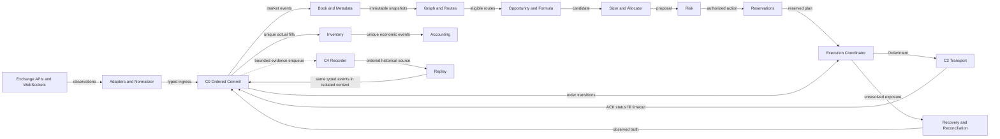

| Field | Meaning |
|---|---|
| Inputs | Exchange market, metadata, account, order and fill observations |
| Outputs | Canonical state, effect intents, reconciled economic state and durable evidence |
| Owner | Ordered domain reducers; the ordered boundary sequences commits but is not a second writer |
| Dependencies | Data versions, Book readiness, Graph generation, Formula, Risk, Reservations and Capability |
| Exceptional paths | Stale/unknown state stops affected new risk; transport results return as events; Recorder handoff stays bounded |
| Authority | [Master Architecture](../../00_MASTER_ARCHITECTURE.md), [state ownership](../../_analysis/pass13_master_architecture/STATE_OWNERSHIP_MATRIX.md), [command/event ownership](../../_analysis/pass13_master_architecture/EVENT_AND_COMMAND_OWNERSHIP_MATRIX.md) |
| Status | Intended current V1 architecture; implementation not verified |

No adapter, transport callback, Recorder, model or operator command may directly mutate economic
truth owned by another reducer.

## 4. `ARCH-MAP-002` — Functional domains and state ownership

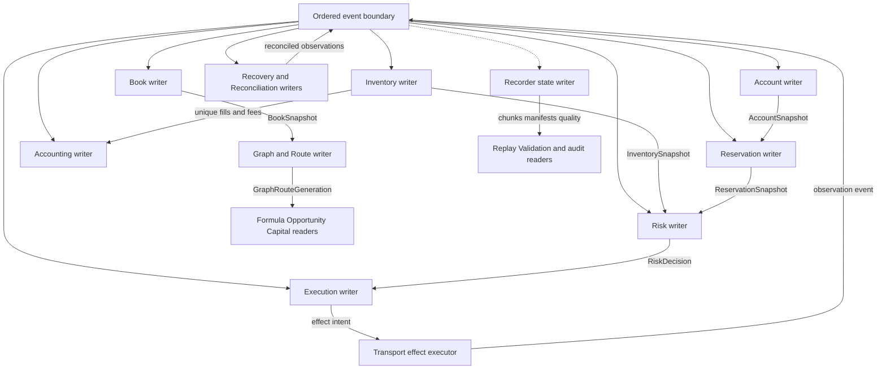

| Field | Meaning |
|---|---|
| Inputs | Ordered observations, bounded capture/health events and immutable versioned snapshots |
| Outputs | One canonical state version per logical owner |
| Owner | Each named domain is sole logical writer for its state family |
| Dependencies | Ordered event boundary, exact versions and authoritative return events |
| Exceptional paths | Stale or contradictory input is rejected, revalidated or fails closed |
| Authority | [Architecture ownership deep spec](03_STATE_OWNERSHIP_EVENTS_COMMANDS_AND_EFFECTS.md), [component ownership](../../_analysis/pass13_master_architecture/COMPONENT_OWNERSHIP_MATRIX.md) |
| Status | Ownership contract documented; implementation not verified |

Accounting consumes unique actual economic events. It does not write Inventory, and Inventory does
not write Accounting records.

## 5. `ARCH-MAP-003` — Temporal architecture and C0-C5 boundaries

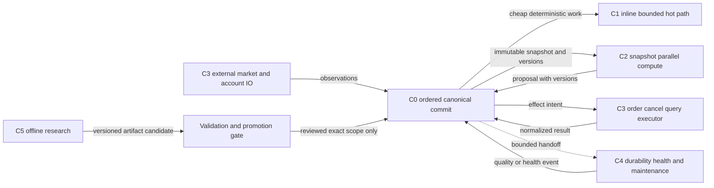

| Field | Meaning |
|---|---|
| Inputs | External observations, immutable snapshots, effect intents and research artifacts |
| Outputs | Ordered commits, bounded proposals, effect results, evidence and reviewed artifacts |
| Owner | C0 domain owners commit; C1-C5 do not create independent economic truth |
| Dependencies | Bounded queues, version checks, deadlines, stale-result rejection and explicit promotion |
| Exceptional paths | First-worker-wins, direct worker mutation, research-to-order and indefinite disk/network waits are forbidden |
| Authority | [Async Concurrency and Ordered Commit](14_ASYNC_CONCURRENCY_AND_ORDERED_COMMIT.md), [async system map](../../_analysis/async_concurrency_architecture/ASYNC_SYSTEM_MAP.md) |
| Status | Responsibility classes specified; runtime scheduling and capacity remain implementation/calibration work |

The governing rule is: **parallel to calculate, ordered to decide, single-writer to commit**.

## 6. `ARCH-MAP-004` — Failure propagation and containment

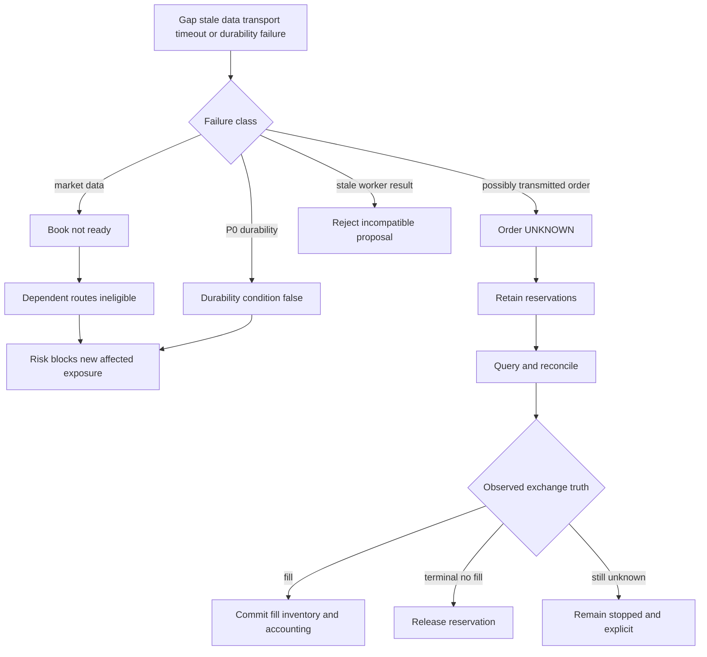

| Field | Meaning |
|---|---|
| Inputs | Data gaps, stale versions, durability loss, timeouts and worker completions |
| Outputs | Scoped non-readiness, blocked new risk, retained reservations, reconciliation or explicit unresolved state |
| Owner | Data/Book for readiness, Risk for permission, Execution for order lifecycle, Reconciliation for observed truth |
| Dependencies | Current state versions, unique fills, P0 evidence and recoverable query paths |
| Exceptional paths | Stopping new risk never suppresses an already observed fill or disables safe Recovery/Reconciliation |
| Authority | [Failure containment](11_FAILURE_CONTAINMENT_AND_DEGRADATION_ARCHITECTURE.md), [Risk](../../09_RISK_CONSTITUTION.md), [Execution](../../10_EXECUTION_STATE_MACHINE.md) |
| Status | Safety behavior specified; implementation and fault-injection evidence absent |

## 7. `ARCH-MAP-005` — Scientific maturity and operational authorization

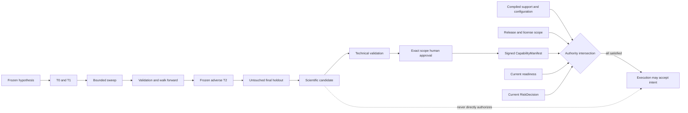

| Field | Meaning |
|---|---|
| Inputs | Frozen hypothesis, point-in-time evidence, technical evidence, manifest and current runtime state |
| Outputs | Scientific disposition, exact-scope capability evidence, or runtime ineligibility |
| Owner | Validation owns evidence; human authority owns approval; Capability owns manifest; Risk owns current permission |
| Dependencies | No-lookahead protocol, maturity evidence, support/config/license/readiness and current Risk |
| Exceptional paths | Scientific success cannot directly create an order, validated q, capital permission or Live promotion |
| Authority | [RunModes and capability](09_RUNMODES_CAPABILITY_ACTIVATION_AND_VALIDATION.md), [Build/Validate/Scale](../../19_BUILD_VALIDATE_SCALE_ROADMAP.md), [F2 lifecycle](../validation/14_ROBUST_REGION_AND_CANDIDATE_LIFECYCLE.md) |
| Status | F2 scientific path proposed; approval, implementation and capital remain separate |

## 8. `ARCH-MAP-006` — Book reconnect walkthrough

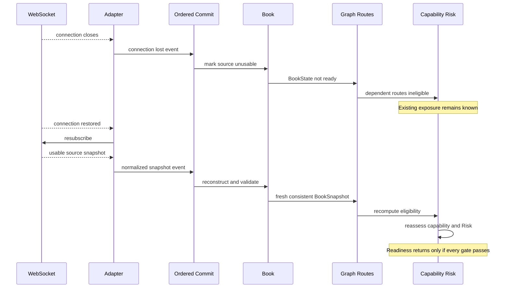

Ordinary path: a valid snapshot restores the Book before route eligibility and safety gates are
reassessed. Failure path: a connected socket without a usable snapshot remains non-ready.

State owners: Adapter owns connection observations; Book owns `BookState`; Graph owns route
eligibility; Capability and Risk own their respective gates.

Authority: [Data Contracts](../../11_DATA_CONTRACTS.md), [Recorder/Replay](../../12_RECORDER_AND_REPLAY.md),
[Market-to-decision pipeline](05_MARKET_TO_DECISION_PIPELINE.md).

## 9. `ARCH-MAP-007` — Graph generation change walkthrough

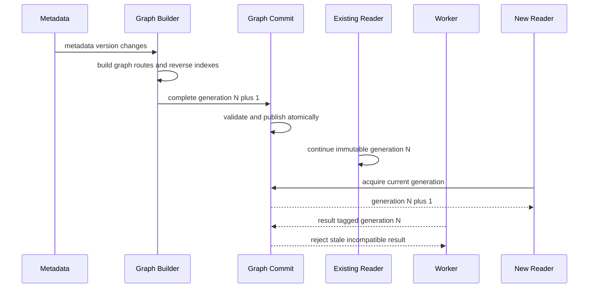

Ordinary path: topology, route definitions and reverse indexes become reader-visible as one
compatible immutable generation. Failure path: an incomplete or incompatible build is not
published; readers continue using the previous generation.

State owner: Graph/Route writer only. Workers build proposals and never publish independently.

Authority: [Graph and Routes](../../03_MARKET_GRAPH_AND_ROUTES.md), [route precomputation](../market-graph/04_ROUTE_PRECOMPUTATION_PAIR_TO_ROUTES_AND_INVALIDATION.md),
[stale-result contract](../../_analysis/async_concurrency_architecture/STALE_RESULT_AND_VERSIONING_CONTRACT.md).

## 10. `ARCH-MAP-008` — Recorder P0 failure walkthrough

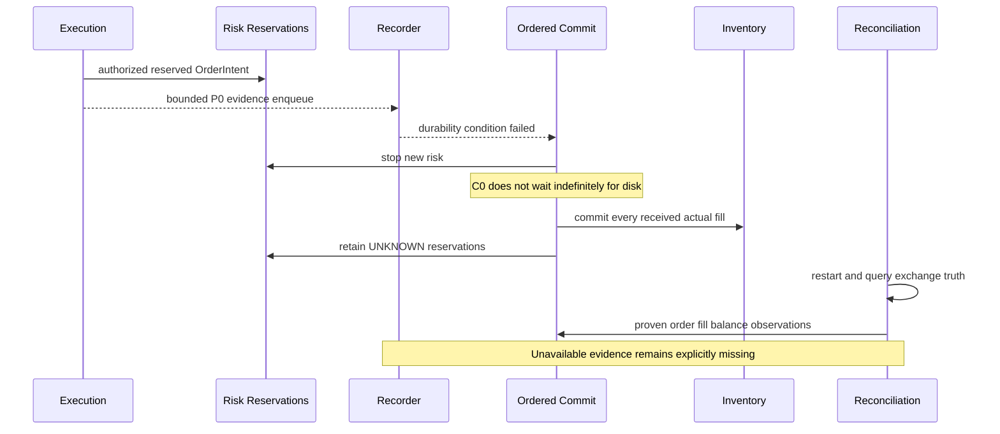

Specified behavior: Recorder handoff is bounded; failure of required durability stops new risk;
received fills still update actual economic state; UNKNOWN retains reservations; restart uses
reconciliation rather than invented evidence.

Implementation details still requiring design or calibration include acknowledgment semantics,
emergency buffers, flush/fsync policy, deadlines, queue capacity and crash consistency.

Authority: [Recorder/Replay](../../12_RECORDER_AND_REPLAY.md), [Recorder priority matrix](../../_analysis/pass06_data_recorder_replay/RECORDER_PRIORITY_AND_BACKPRESSURE_MATRIX.md),
[Execution/Recovery pipeline](06_EXECUTION_RECOVERY_AND_RECONCILIATION_PIPELINE.md).

## 11. `ARCH-MAP-009` — Partial TT execution walkthrough

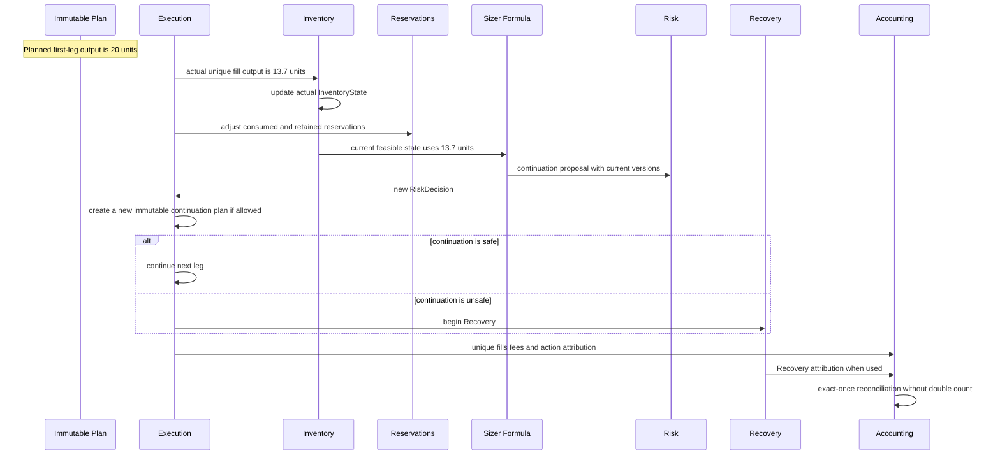

The original plan remains immutable evidence. Actual 13.7-unit state, not planned 20-unit output,
drives the next sizing, Risk and Execution decision. Recovery cannot bypass Risk, and Accounting
cannot fabricate or duplicate exposure.

Authority: [Execution State Machine](../../10_EXECUTION_STATE_MACHINE.md), [Inventory and Capital](../../08_INVENTORY_AND_CAPITAL.md),
[Risk](../../09_RISK_CONSTITUTION.md), [accounting reconciliation](../../_analysis/corr05_economic_integration/ACCOUNTING_RECONCILIATION_MAP.md).

## 12. `ARCH-MAP-010` — Scientific candidate walkthrough

```mermaid
flowchart LR
    H["1 Fixed hypothesis"] --> F["2 Frozen experiment"]
    F --> T01["3 T0 and T1"]
    T01 --> S["4 Bounded sweep"]
    S --> V["5 Validation and walk forward"]
    V --> T2["6 Frozen adverse T2"]
    T2 --> HO["7 Untouched holdout"]
    HO --> C["8 Scientific candidate"]
    C --> TV["9 Separate technical validation"]
    TV --> HA["10 Exact scope human approval"]
    HA --> I["11 Capability readiness and Risk intersection"]
    I --> O["Execution eligibility"]
    C -.->|no direct authority| O
```

Failure at any scientific stage produces a negative, inconclusive or invalid result that remains in
the evidence record. Holdout success does not grant implementation, Shadow, Live, capital or order
permission.

Research/Validation own experiments and candidate evidence; Capability owns the exact manifest;
Risk owns current permission; Execution alone creates `OrderIntent` after every gate is satisfied.

Authority: [Economic Falsifier](../validation/13_ECONOMIC_FALSIFIER_AND_BOUNDED_SWEEP.md), [candidate lifecycle](../validation/14_ROBUST_REGION_AND_CANDIDATE_LIFECYCLE.md),
[Validation Matrix](../../16_VALIDATION_MATRIX.md).

## 13. `ARCH-MAP-011` — Risk and Execution pipeline

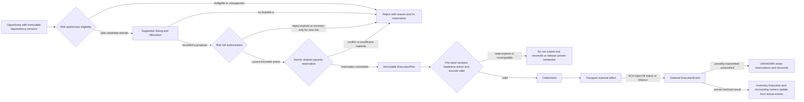

| Field | Meaning |
|---|---|
| Purpose | Show the single Risk authority at preliminary and full checkpoints without treating either checkpoint as a Submit command |
| Inputs | Versioned Opportunity, Book/Graph/Account/Inventory snapshots, supported model outputs and current capability/readiness |
| Outputs | Reject reason, bounded `RiskDecision`, reservation, immutable plan, `OrderIntent` or ordered result event |
| Owner | Risk owns both Risk checkpoints; Sizing proposes q; Reservations own claims; Execution owns plan/order lifecycle; Transport performs effects |
| Decisions / errors | Unsupported model, no feasible q, Risk rejection, reservation conflict, expiry/staleness and `UNKNOWN` all fail closed for new risk |
| Version / freshness | Full authorization and pre-send checks require current compatible versions; an early eligibility check never substitutes for them |
| Authority | [Risk](../../09_RISK_CONSTITUTION.md), [Execution](../../10_EXECUTION_STATE_MACHINE.md), [decision pipeline](../../_analysis/pass13_master_architecture/DECISION_PIPELINE_MAP.md) |
| Related | `ARCH-006`, `ARCH-009`, `ARCH-024`, `ARCH-026`, `ARCH-027`; A-05, A-07, A-16–A-18, A-23 |
| Status | Documentary ordering clarified; exact `allowed`/`action` compatibility and field-level `RiskReservation` schema remain OPEN human/source decisions; implementation not verified |

## 14. `ARCH-MAP-012` — Two routes share L2 liquidity

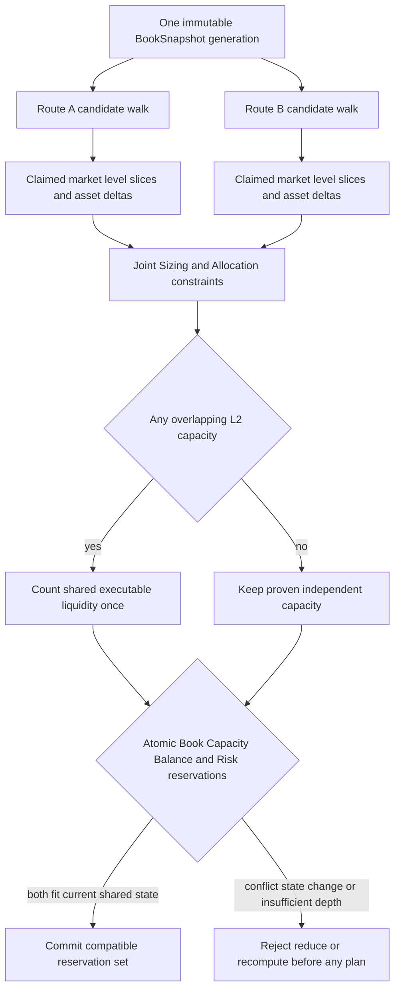

Illustrative example: two apparent opportunities reference the same executable book level. Their
standalone quantities may each look feasible, but the common units are available only once. The
Allocator and Reservation owners must compare both against one current shared-capacity state; no
sum of standalone simulations may manufacture extra depth.

| Field | Meaning |
|---|---|
| Purpose | Make A-19 and the no-double-reservation rule visible |
| Inputs | Immutable Book versions, per-route depth dependencies, candidate q and existing reservations |
| Outputs | Compatible atomic reservation set, reduced/recomputed candidates or rejection |
| Owner | Book owns observed depth; Sizing/Allocation owns joint proposal; Reservations own the atomic capacity claim |
| Decisions / errors | Overlap, stale generation, competing claim or insufficient observed depth prevents double use |
| Version / freshness | Every claim carries compatible Book/Graph/route/account/risk versions and is revalidated before effect |
| Authority | [Graph and Routes](../../03_MARKET_GRAPH_AND_ROUTES.md), [Inventory and Capital](../../08_INVENTORY_AND_CAPITAL.md), [Execution](../../10_EXECUTION_STATE_MACHINE.md) |
| Related | `ARCH-009`, `ARCH-014`, `ARCH-018`, `ARCH-023`, `ARCH-027`; A-07, A-18, A-19 |
| Status | Documentary capacity semantics; numerical allocator/search policy and implementation tests remain unverified |

## 15. `ARCH-MAP-013` — Simulator says profitable, Risk refuses

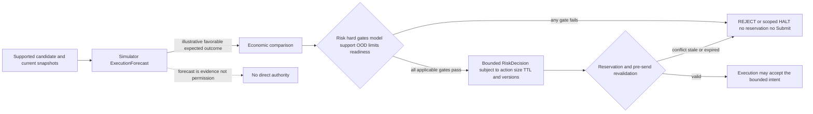

Illustrative example: a forecast can show positive expected economics while a hard inventory
limit, unsupported q band, OOD model state, stale dependency or readiness failure causes Risk to
refuse new exposure. Positive model output is never converted into permission or capital.

| Field | Meaning |
|---|---|
| Purpose | Separate model/economic evidence from Risk sovereignty and effect authorization |
| Inputs | `ExecutionForecast`, economic output, model support/OOD evidence, current snapshots, readiness and capability |
| Outputs | Reject/halt reason or a bounded current `RiskDecision`; never a direct Simulator order |
| Owner | Simulator owns forecast; Formula owns economics; Risk owns permission; Reservations/Execution own later stages |
| Decisions / errors | Unsupported/OOD model, hard-gate failure, stale decision, reservation conflict or pre-send mismatch prevents Submit |
| Version / freshness | Forecast support, q band, state/config/model versions, TTL and pre-send state must remain compatible |
| Authority | [Simulator](../../07_COUNTERFACTUAL_SIMULATOR.md), [Risk](../../09_RISK_CONSTITUTION.md), [model execution risk](../risk/04_MODEL_EXECUTION_AND_TAIL_RISK.md) |
| Related | `ARCH-002`, `ARCH-006`, `ARCH-024`–`ARCH-027`; A-05, A-08, A-11, A-12, A-14, A-23 |
| Status | Documentary refusal path clarified; model calibration, support evidence and implementation remain unverified |

## 16. Known open documentary boundaries

The atlas intentionally preserves these unresolved or review-scoped boundaries rather than drawing
an invented solution:

- the exact `RiskDecision.action` to compatibility-boolean mapping;
- the exact field-level `RiskReservation` schema;
- calibrated Recorder capacities, durability acknowledgment and failure deadlines;
- the ingress source-priority table and cross-recorder merge policy;
- implementation evidence for atomic Graph/Route generation publication;
- explicit Accounting record identity/version in the state-ownership inventory;
- current external exchange semantics, which require dated revalidation at implementation time.

These are inputs to future approved correction or implementation passes, not permissions created by
the diagrams.
