# Architecture Visual Atlas

`DOCUMENTATION STATUS: AWAITING HUMAN REVIEW`

This atlas is the maintained visual entry point for understanding how the system is intended to
work across domain, temporal, failure, evidence and operational boundaries. It supplements the
[Master Architecture](../../00_MASTER_ARCHITECTURE.md) and the owning domain contracts; it never
overrides them.

The diagrams describe documentary contracts. They are not implementation evidence, passed tests,
capability activation, Live permission or capital authorization.

## Atlas authority boundary

This is the sole **maintained cross-domain visual catalog**. It owns stable `ARCH-MAP-*`
identifiers, navigation and current explanatory renderings, but never the underlying domain
semantics. Masters and owning deep contracts remain authoritative. The F2 five-map atlas is a
candidate-specific review snapshot: it may link here for drill-down, but future diagrams are not
duplicated there and changes here do not retroactively certify or rewrite a selected F2 snapshot.

## 1. How to extend this atlas

Future architecture diagrams belong here when they explain a cross-domain flow or provide a
navigation view that is useful beyond one analysis pass.

1. Give each diagram a stable `ARCH-MAP-NNN` identifier and never renumber an existing map.
2. Add it to the catalog before adding the Mermaid source.
3. State its inputs, outputs, owner, dependencies, exceptional paths, authority and status.
4. Link to the owning contract instead of restating or silently changing domain truth.
5. Keep every arrow meaningful: data, event, command, effect, proposal, evidence or permission.
6. Keep optional, Later V1, Future and Research paths visually distinct from current V1.
7. Validate Mermaid syntax before merge when a compiler is available.

If a diagram and an owning contract disagree, the contract wins and the diagram must be corrected.
A semantic change to ownership, ordering, Risk, Execution truth or authorization still requires the
normal architecture and human-review process.

## 2. Map catalog

| Map ID | View | Primary authority | Scope |
|---|---|---|---|
| `ARCH-MAP-001` | Global system | Master Architecture; PASS 13 ownership contracts | Current V1 orientation |
| `ARCH-MAP-002` | Functional domains and state ownership | State and component ownership matrices | Current V1 orientation |
| `ARCH-MAP-003` | C0-C5 temporal architecture | Async concurrency and ordered commit | Current V1 plus isolated Research |
| `ARCH-MAP-004` | Failure propagation and containment | Risk, Recorder, Execution, Recovery/Reconciliation | Current V1 safety behavior |
| `ARCH-MAP-005` | Scientific maturity and operational authorization | Validation, Capability and F2 contracts | Evidence and permission boundary |
| `ARCH-MAP-006` | Book reconnect walkthrough | Data, Book, Graph, Capability and Risk | Operational walkthrough |
| `ARCH-MAP-007` | Graph generation change walkthrough | Graph/Routes and stale-result contracts | Operational walkthrough |
| `ARCH-MAP-008` | Recorder P0 failure walkthrough | Recorder, Risk and Reconciliation | Operational walkthrough |
| `ARCH-MAP-009` | Partial TT execution walkthrough | Execution, Inventory, Reservations and Accounting | Operational walkthrough |
| `ARCH-MAP-010` | Scientific candidate walkthrough | Falsifier, Validation and Capability | Scientific walkthrough |
| `ARCH-MAP-011` | Risk and Execution pipeline | Risk, Sizing, Reservations and Execution | Operational walkthrough |
| `ARCH-MAP-012` | Shared L2 liquidity and atomic capacity | Book, Sizing, Allocation and Reservations | Capacity walkthrough |
| `ARCH-MAP-013` | Favorable Simulator output refused by Risk | Simulator, Risk and Execution | Authorization walkthrough |
| `ARCH-MAP-014` | RAW identity, normalization outcome and ordered evidence | Data, Recorder, Async and Replay | Ingestion/evidence walkthrough |
| `ARCH-MAP-015` | Feed Adapter, Normalizer and Book functions | Data, Book and readiness contracts | Functional drill-down |
| `ARCH-MAP-016` | Metadata, Graph, Routes and reverse indexes | Graph/Routes and generation contracts | Functional drill-down |
| `ARCH-MAP-017` | NetConvert, Formula and Opportunity functions | Formula Book and Opportunity contracts | Functional drill-down |
| `ARCH-MAP-018` | Features, Participants and Simulator functions | Quant, Participants and Simulator contracts | Functional drill-down |
| `ARCH-MAP-019` | Inventory, Reachability, Terminal and Sizing functions | Inventory/Capital and Risk contracts | Functional drill-down |
| `ARCH-MAP-020` | Risk, Reservation and Execution functions | Risk and Execution contracts | Functional drill-down |
| `ARCH-MAP-021` | Partial fill, Recovery and Reconciliation functions | Execution, Inventory and Risk contracts | Functional drill-down |
| `ARCH-MAP-022` | Accounting functions and economic truth | Accounting, Formula and Data contracts | Functional drill-down |
| `ARCH-MAP-023` | Recorder, Replay and DecisionTrace functions | Data, Recorder and Replay contracts | Functional drill-down |
| `ARCH-MAP-024` | Capability, Validation and Deployment functions | Validation, Deployment and Risk contracts | Functional drill-down |

## 3. `ARCH-MAP-001` — Global system

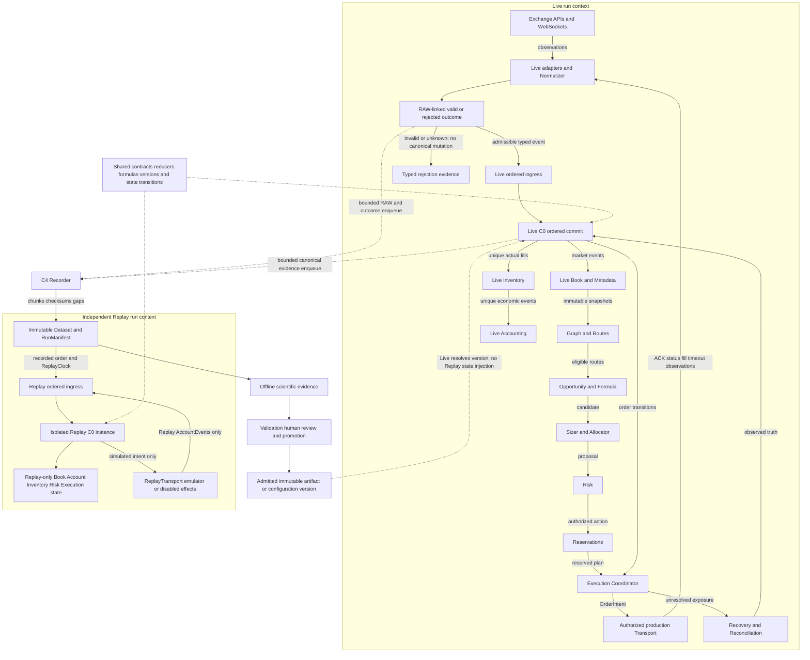

| Field | Meaning |
|---|---|
| Inputs | Exchange market, metadata, account, order and fill observations |
| Outputs | Live canonical/economic state, isolated Replay state, effect intents and durable evidence |
| Owner | Ordered domain reducers; the ordered boundary sequences commits but is not a second writer |
| Dependencies | Data versions, Book readiness, Graph generation, Formula, Risk, Reservations and Capability |
| Exceptional paths | Stale/unknown state stops affected new risk; transport results return as events; Recorder handoff stays bounded; Replay cannot target Live state/Transport |
| Authority | [Master Architecture](../../00_MASTER_ARCHITECTURE.md), [state ownership](../../_analysis/pass13_master_architecture/STATE_OWNERSHIP_MATRIX.md), [command/event ownership](../../_analysis/pass13_master_architecture/EVENT_AND_COMMAND_OWNERSHIP_MATRIX.md) |
| Status | Intended current V1 architecture; implementation not verified |

No adapter, transport callback, Recorder, model or operator command may directly mutate economic
truth owned by another reducer. Live and Replay reuse the same implementation semantics but never
the same mutable Account, Inventory, Reservation, Execution or Risk state.

## 4. `ARCH-MAP-002` — Functional domains and state ownership

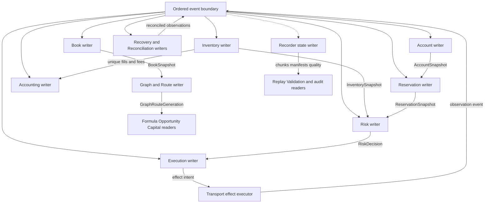

| Field | Meaning |
|---|---|
| Inputs | Ordered observations, bounded capture/health events and immutable versioned snapshots |
| Outputs | One canonical state version per logical owner |
| Owner | Each named domain is sole logical writer for its state family |
| Dependencies | Ordered event boundary, exact versions and authoritative return events |
| Exceptional paths | Stale or contradictory input is rejected, revalidated or fails closed |
| Authority | [Architecture ownership deep spec](03_STATE_OWNERSHIP_EVENTS_COMMANDS_AND_EFFECTS.md), [component ownership](../../_analysis/pass13_master_architecture/COMPONENT_OWNERSHIP_MATRIX.md) |
| Status | Ownership contract documented; implementation not verified |

Accounting consumes unique actual economic events. It does not write Inventory, and Inventory does
not write Accounting records.

## 5. `ARCH-MAP-003` — Temporal architecture and C0-C5 boundaries

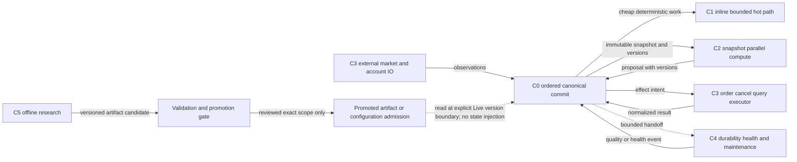

| Field | Meaning |
|---|---|
| Inputs | External observations, immutable snapshots, effect intents and research artifacts |
| Outputs | Ordered commits, bounded proposals, effect results, evidence and reviewed artifacts |
| Owner | C0 domain owners commit; C1-C5 do not create independent economic truth |
| Dependencies | Bounded queues, version checks, deadlines, stale-result rejection and explicit promotion |
| Exceptional paths | First-worker-wins, direct worker mutation, research-to-order and indefinite disk/network waits are forbidden |
| Authority | [Async Concurrency and Ordered Commit](14_ASYNC_CONCURRENCY_AND_ORDERED_COMMIT.md), [async system map](../../_analysis/async_concurrency_architecture/ASYNC_SYSTEM_MAP.md) |
| Status | Responsibility classes specified; runtime scheduling and capacity remain implementation/calibration work |

The governing rule is: **parallel to calculate, ordered to decide, single-writer to commit**.

## 6. `ARCH-MAP-004` — Failure propagation and containment

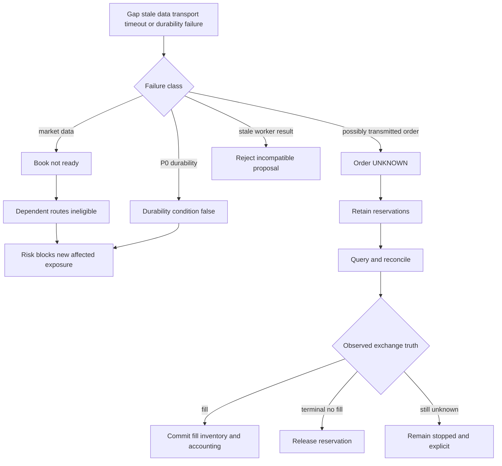

| Field | Meaning |
|---|---|
| Inputs | Data gaps, stale versions, durability loss, timeouts and worker completions |
| Outputs | Scoped non-readiness, blocked new risk, retained reservations, reconciliation or explicit unresolved state |
| Owner | Data/Book for readiness, Risk for permission, Execution for order lifecycle, Reconciliation for observed truth |
| Dependencies | Current state versions, unique fills, P0 evidence and recoverable query paths |
| Exceptional paths | Stopping new risk never suppresses an already observed fill or disables safe Recovery/Reconciliation |
| Authority | [Failure containment](11_FAILURE_CONTAINMENT_AND_DEGRADATION_ARCHITECTURE.md), [Risk](../../09_RISK_CONSTITUTION.md), [Execution](../../10_EXECUTION_STATE_MACHINE.md) |
| Status | Safety behavior specified; implementation and fault-injection evidence absent |

## 7. `ARCH-MAP-005` — Scientific maturity and operational authorization

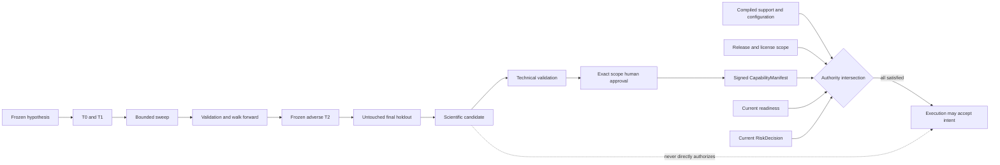

| Field | Meaning |
|---|---|
| Inputs | Frozen hypothesis, point-in-time evidence, technical evidence, manifest and current runtime state |
| Outputs | Scientific disposition, exact-scope capability evidence, or runtime ineligibility |
| Owner | Validation owns evidence; human authority owns approval; Capability owns manifest; Risk owns current permission |
| Dependencies | No-lookahead protocol, maturity evidence, support/config/license/readiness and current Risk |
| Exceptional paths | Scientific success cannot directly create an order, validated q, capital permission or Live promotion |
| Authority | [RunModes and capability](09_RUNMODES_CAPABILITY_ACTIVATION_AND_VALIDATION.md), [Build/Validate/Scale](../../19_BUILD_VALIDATE_SCALE_ROADMAP.md), [F2 lifecycle](../validation/14_ROBUST_REGION_AND_CANDIDATE_LIFECYCLE.md) |
| Status | F2 scientific path proposed; approval, implementation and capital remain separate |

## 8. `ARCH-MAP-006` — Book reconnect walkthrough

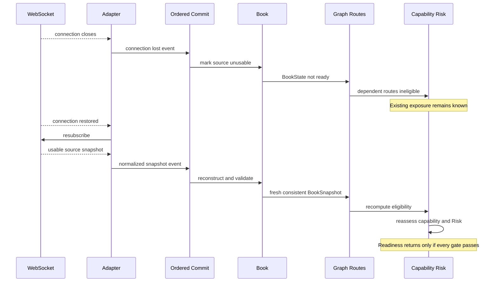

Ordinary path: a valid snapshot restores the Book before route eligibility and safety gates are
reassessed. Failure path: a connected socket without a usable snapshot remains non-ready.

State owners: Adapter owns connection observations; Book owns `BookState`; Graph owns route
eligibility; Capability and Risk own their respective gates.

Authority: [Data Contracts](../../11_DATA_CONTRACTS.md), [Recorder/Replay](../../12_RECORDER_AND_REPLAY.md),
[Market-to-decision pipeline](05_MARKET_TO_DECISION_PIPELINE.md).

## 9. `ARCH-MAP-007` — Graph generation change walkthrough

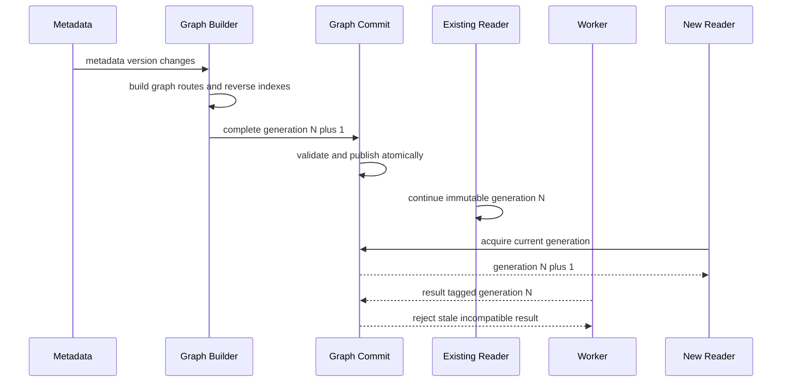

Ordinary path: topology, route definitions and reverse indexes become reader-visible as one
compatible immutable generation. Failure path: an incomplete or incompatible build is not
published; readers continue using the previous generation.

State owner: Graph/Route writer only. Workers build proposals and never publish independently.

Authority: [Graph and Routes](../../03_MARKET_GRAPH_AND_ROUTES.md), [route precomputation](../market-graph/04_ROUTE_PRECOMPUTATION_PAIR_TO_ROUTES_AND_INVALIDATION.md),
[stale-result contract](../../_analysis/async_concurrency_architecture/STALE_RESULT_AND_VERSIONING_CONTRACT.md).

## 10. `ARCH-MAP-008` — Recorder P0 failure walkthrough

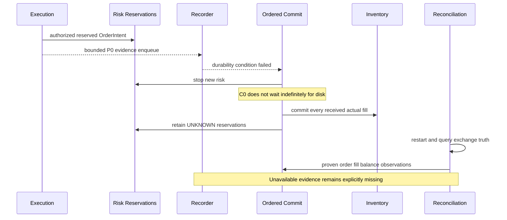

Specified behavior: Recorder handoff is bounded; failure of required durability stops new risk;
received fills still update actual economic state; UNKNOWN retains reservations; restart uses
reconciliation rather than invented evidence.

Implementation details still requiring design or calibration include acknowledgment semantics,
emergency buffers, flush/fsync policy, deadlines, queue capacity and crash consistency.

Authority: [Recorder/Replay](../../12_RECORDER_AND_REPLAY.md), [Recorder priority matrix](../../_analysis/pass06_data_recorder_replay/RECORDER_PRIORITY_AND_BACKPRESSURE_MATRIX.md),
[Execution/Recovery pipeline](06_EXECUTION_RECOVERY_AND_RECONCILIATION_PIPELINE.md).

## 11. `ARCH-MAP-009` — Partial TT execution walkthrough

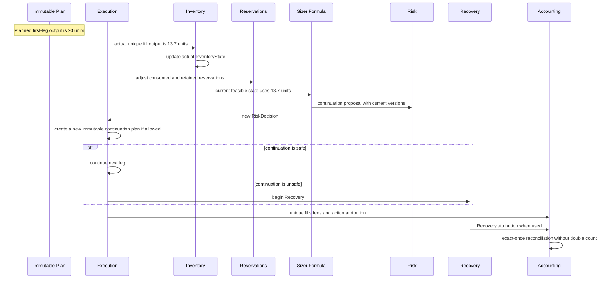

The original plan remains immutable evidence. Actual 13.7-unit state, not planned 20-unit output,
drives the next sizing, Risk and Execution decision. Recovery cannot bypass Risk, and Accounting
cannot fabricate or duplicate exposure.

Authority: [Execution State Machine](../../10_EXECUTION_STATE_MACHINE.md), [Inventory and Capital](../../08_INVENTORY_AND_CAPITAL.md),
[Risk](../../09_RISK_CONSTITUTION.md), [accounting reconciliation](../../_analysis/corr05_economic_integration/ACCOUNTING_RECONCILIATION_MAP.md).

## 12. `ARCH-MAP-010` — Scientific candidate walkthrough

```mermaid
flowchart LR
    H["1 Fixed hypothesis"] --> F["2 Frozen experiment"]
    F --> T01["3 T0 and T1"]
    T01 --> S["4 Bounded sweep"]
    S --> V["5 Validation and walk forward"]
    V --> T2["6 Frozen adverse T2"]
    T2 --> HO["7 Untouched holdout"]
    HO --> C["8 Scientific candidate"]
    C --> TV["9 Separate technical validation"]
    TV --> HA["10 Exact scope human approval"]
    HA --> I["11 Capability readiness and Risk intersection"]
    I --> O["Execution eligibility"]
    C -.->|no direct authority| O
```

Failure at any scientific stage produces a negative, inconclusive or invalid result that remains in
the evidence record. Holdout success does not grant implementation, Shadow, Live, capital or order
permission.

Research/Validation own experiments and candidate evidence; Capability owns the exact manifest;
Risk owns current permission; Execution alone creates `OrderIntent` after every gate is satisfied.

Authority: [Economic Falsifier](../validation/13_ECONOMIC_FALSIFIER_AND_BOUNDED_SWEEP.md), [candidate lifecycle](../validation/14_ROBUST_REGION_AND_CANDIDATE_LIFECYCLE.md),
[Validation Matrix](../../16_VALIDATION_MATRIX.md).

## 13. `ARCH-MAP-011` — Risk and Execution pipeline

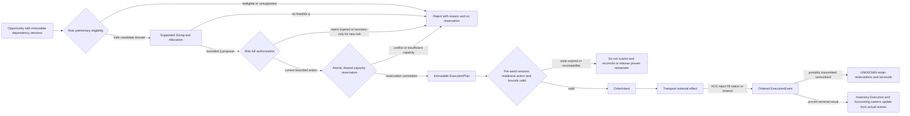

| Field | Meaning |
|---|---|
| Purpose | Show the single Risk authority at preliminary and full checkpoints without treating either checkpoint as a Submit command |
| Inputs | Versioned Opportunity, Book/Graph/Account/Inventory snapshots, supported model outputs and current capability/readiness |
| Outputs | Reject reason, bounded `RiskDecision`, reservation, immutable plan, `OrderIntent` or ordered result event |
| Owner | Risk owns both Risk checkpoints; Sizing proposes q; Reservations own claims; Execution owns plan/order lifecycle; Transport performs effects |
| Decisions / errors | Unsupported model, no feasible q, Risk rejection, reservation conflict, expiry/staleness and `UNKNOWN` all fail closed for new risk |
| Version / freshness | Full authorization and pre-send checks require current compatible versions; an early eligibility check never substitutes for them |
| Authority | [Risk](../../09_RISK_CONSTITUTION.md), [Execution](../../10_EXECUTION_STATE_MACHINE.md), [decision pipeline](../../_analysis/pass13_master_architecture/DECISION_PIPELINE_MAP.md) |
| Related | `ARCH-006`, `ARCH-009`, `ARCH-024`, `ARCH-026`, `ARCH-027`; A-05, A-07, A-16–A-18, A-23 |
| Status | Documentary ordering clarified; exact `allowed`/`action` compatibility and field-level `RiskReservation` schema remain OPEN human/source decisions; implementation not verified |

## 14. `ARCH-MAP-012` — Two routes share L2 liquidity

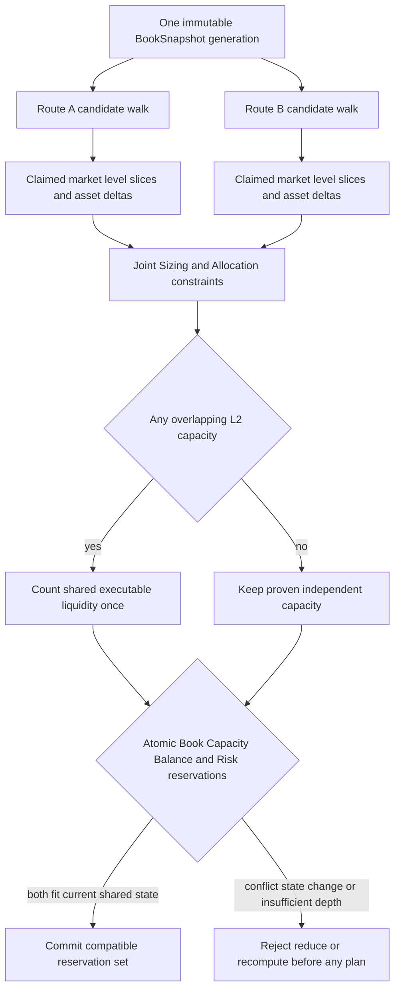

Illustrative example: two apparent opportunities reference the same executable book level. Their
standalone quantities may each look feasible, but the common units are available only once. The
Allocator and Reservation owners must compare both against one current shared-capacity state; no
sum of standalone simulations may manufacture extra depth.

| Field | Meaning |
|---|---|
| Purpose | Make A-19 and the no-double-reservation rule visible |
| Inputs | Immutable Book versions, per-route depth dependencies, candidate q and existing reservations |
| Outputs | Compatible atomic reservation set, reduced/recomputed candidates or rejection |
| Owner | Book owns observed depth; Sizing/Allocation owns joint proposal; Reservations own the atomic capacity claim |
| Decisions / errors | Overlap, stale generation, competing claim or insufficient observed depth prevents double use |
| Version / freshness | Every claim carries compatible Book/Graph/route/account/risk versions and is revalidated before effect |
| Authority | [Graph and Routes](../../03_MARKET_GRAPH_AND_ROUTES.md), [Inventory and Capital](../../08_INVENTORY_AND_CAPITAL.md), [Execution](../../10_EXECUTION_STATE_MACHINE.md) |
| Related | `ARCH-009`, `ARCH-014`, `ARCH-018`, `ARCH-023`, `ARCH-027`; A-07, A-18, A-19 |
| Status | Documentary capacity semantics; numerical allocator/search policy and implementation tests remain unverified |

## 15. `ARCH-MAP-013` — Simulator says profitable, Risk refuses

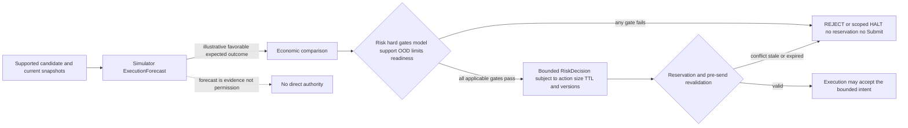

Illustrative example: a forecast can show positive expected economics while a hard inventory
limit, unsupported q band, OOD model state, stale dependency or readiness failure causes Risk to
refuse new exposure. Positive model output is never converted into permission or capital.

| Field | Meaning |
|---|---|
| Purpose | Separate model/economic evidence from Risk sovereignty and effect authorization |
| Inputs | `ExecutionForecast`, economic output, model support/OOD evidence, current snapshots, readiness and capability |
| Outputs | Reject/halt reason or a bounded current `RiskDecision`; never a direct Simulator order |
| Owner | Simulator owns forecast; Formula owns economics; Risk owns permission; Reservations/Execution own later stages |
| Decisions / errors | Unsupported/OOD model, hard-gate failure, stale decision, reservation conflict or pre-send mismatch prevents Submit |
| Version / freshness | Forecast support, q band, state/config/model versions, TTL and pre-send state must remain compatible |
| Authority | [Simulator](../../07_COUNTERFACTUAL_SIMULATOR.md), [Risk](../../09_RISK_CONSTITUTION.md), [model execution risk](../risk/04_MODEL_EXECUTION_AND_TAIL_RISK.md) |
| Related | `ARCH-002`, `ARCH-006`, `ARCH-024`–`ARCH-027`; A-05, A-08, A-11, A-12, A-14, A-23 |
| Status | Documentary refusal path clarified; model calibration, support evidence and implementation remain unverified |

## 16. `ARCH-MAP-014` — RAW identity, normalization outcome and ordered evidence

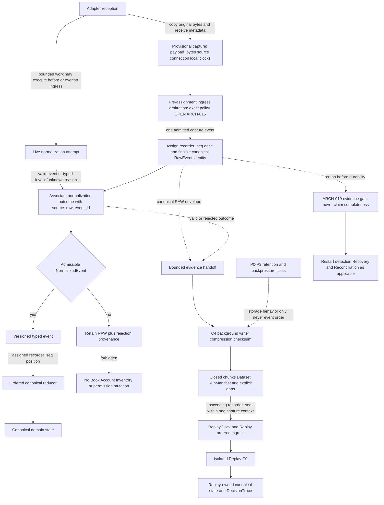

The arrows show required data dependencies and ownership, not a mandatory total physical schedule.
In particular, bounded normalization may run before or overlap ingress; the valid/rejected outcome
becomes usable only after association with the finalized RAW identity. What is fixed is one
`recorder_seq` assignment per admitted capture event, immutable post-assignment order, evidence for
both success and rejection, ordered application of valid events, and background persistence that
cannot create another sequence authority.

| Field | Meaning |
|---|---|
| Purpose | Explain how an invalid or unknown payload remains ordered RAW evidence even though no valid event reaches a reducer |
| Inputs | Original source bytes, source/connection identity, local receive clocks and versioned normalization rules |
| Outputs | Final `RawEvent`, valid `NormalizedEvent` or typed rejection, bounded persistence handoff, Dataset/RunManifest and isolated Replay input |
| Owner | Data owns schema/ordering; ingress assigns `recorder_seq`; domain reducers own state; Recorder owns durability; Replay owns its independent run state |
| Decisions / errors | Exact pre-assignment arbitration and cross-recorder merge remain OPEN; invalid/unknown input cannot mutate state or fabricate a type |
| Version / freshness | Capture context, RAW/normalization schema, source connection, dataset/run manifest and Replay versions remain explicit |
| Exceptional paths | Writer priority/completion never reorders; a crash after assignment creates an explicit gap and invokes the ARCH-019 safety/reconciliation boundary |
| Authority | [Data Contracts](../../11_DATA_CONTRACTS.md), [Recorder/Replay](../../12_RECORDER_AND_REPLAY.md), [Event Ordering](../../_analysis/pass06_data_recorder_replay/EVENT_ORDERING_CONTRACT.md), [Async map](../../_analysis/async_concurrency_architecture/ASYNC_SYSTEM_MAP.md) |
| Related | `ARCH-001`, `ARCH-003`, `ARCH-016`–`ARCH-021`; RAW-ORDER-01–07 and REPLAY-ISO-01–04 |
| Status | Documentary lifecycle specified; acceptance/runtime/durability tests NOT EXECUTED; implementation not verified |

## 17. Functional navigation contract

`ARCH-MAP-015..024` are the maintained functional drill-down layer for Prompt 2. They use
documentary operation IDs from the functional correction report until an implementation exists;
they do not assert Rust symbol names. Each map exposes the same navigation chain:

`L0 system context -> L1 domain -> L2 module/interface -> L3 documented operation -> L4 contract/acceptance scenario`.

The authoritative component and producer/consumer inventories remain the PASS 13
[Component Catalog](../../_analysis/pass13_master_architecture/COMPONENT_CATALOG.md) and
[Domain Interface Catalog](../../_analysis/pass13_master_architecture/DOMAIN_INTERFACE_CATALOG.md).
The [Prompt 2 functional report](../../_analysis/f2_final_integration/PROMPT2_FUNCTIONAL_ARCHITECTURE_CORRECTION_REPORT.md)
provides the complete operation and `FUNC-*` traceability matrices without becoming a domain
authority. A later implementation review may attach verified source symbols to these stable
documentary operations; it must not silently replace their owning contracts.

## 18. `ARCH-MAP-015` — Feed Adapter, Normalizer and Book functions

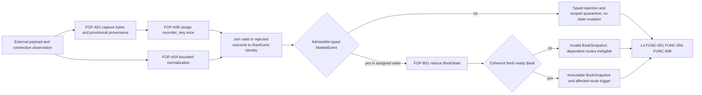

| Contract field | Functional meaning |
|---|---|
| Input / validation | Original bytes, source/connection clocks and schema; unknown/invalid input is retained but cannot mutate Book |
| Processing / decision | One ingress sequence, ordered reducer, snapshot invariants and distinct `CONNECTED -> ... -> BOOK_VALID` readiness |
| Output / state effect | `RawEvent`, typed event or rejection, then one Book-writer mutation and immutable `BookSnapshot` |
| Failure / fallback | Reject/quarantine invalid scope; gap/stale/crossed state invalidates the affected Book until snapshot/resync |
| Versions / consumers | RAW/normalization schema, connection, `recorder_seq`, Book/metadata versions; Graph/Features/Opportunity/Risk consume |
| Source / status | [Data Contracts](../../11_DATA_CONTRACTS.md), [Data schemas](../data/02_RAW_NORMALIZED_AND_DOMAIN_EVENT_SCHEMAS.md); specified, implementation tests absent |

## 19. `ARCH-MAP-016` — Metadata, Graph, Routes and `pair_to_routes`

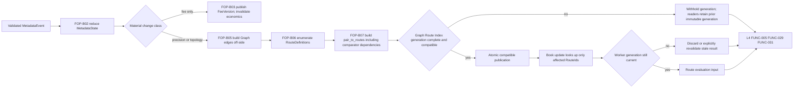

| Contract field | Functional meaning |
|---|---|
| Input / validation | Point-in-time metadata/status/precision; invalid or contradictory material metadata disables affected conversions |
| Processing / decision | Two directed edges per eligible market, deterministic fixed-route enumeration and reverse-index build |
| Output / state effect | Sole Graph/Route writer publishes one coherent immutable Graph/Route/index generation |
| Failure / fallback | No mixed generation; previous readers may finish on the old generation; stale worker cannot commit |
| Versions / consumers | Metadata, Graph, Route and index generation; Opportunity/Execution/Replay consume stable canonical IDs |
| Source / status | [Graph master](../../03_MARKET_GRAPH_AND_ROUTES.md), [precomputation](../market-graph/04_ROUTE_PRECOMPUTATION_PAIR_TO_ROUTES_AND_INVALIDATION.md); specified, implementation atomicity unverified |

## 20. `ARCH-MAP-017` — NetConvert, Formula and Opportunity functions

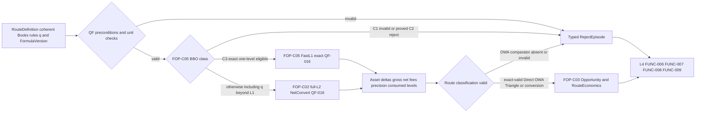

| Contract field | Functional meaning |
|---|---|
| Input / validation | Exact q/asset units, directed side, observed protected L2, point-in-time fee/precision/minimum and coherent versions |
| Processing / decision | QF-009/010 walk, QF-014/015 fee, QF-016 result; FastL1 changes traversal only and otherwise falls back |
| Output / state effect | Pure `RouteEconomics`, Opportunity or typed rejection; no Book, Inventory, Risk or order mutation |
| Failure / fallback | Insufficient depth, unknown rule, invalid minimum/precision or missing fair OWA comparator rejects; no invented liquidity |
| Versions / consumers | Book/Graph/Route/metadata/fee/precision/Formula/q; Opportunity/Sizer/Risk/evidence consume |
| Source / status | [Formula Book](../../04_FORMULA_BOOK.md), [Opportunity economics](../market-graph/05_OPPORTUNITY_DETECTION_AND_SIZE_DEPENDENT_ECONOMICS.md); QF unchanged, implementation parity unverified |

## 21. `ARCH-MAP-018` — Features, Participants and Simulator functions

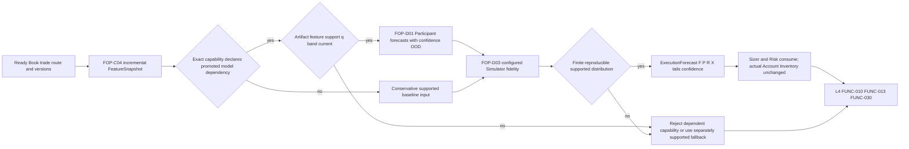

| Contract field | Functional meaning |
|---|---|
| Input / validation | Point-in-time `FeatureSnapshot`, candidate/q, artifact support, feed fidelity, model/fidelity/config and explicit seed where stochastic |
| Processing / decision | Bounded inference then one configured Simulator; F0/F1 baseline may omit advanced models, F4 remains offline Research |
| Output / state effect | Forecasts and `ExecutionForecast`; model/Simulator state only, never actual Fill/Account/Inventory truth or permission |
| Failure / fallback | Missing/OOD/stale model blocks only dependent scope; supported conservative fallback carries its own validation envelope |
| Versions / consumers | Feature/model/formula/book/route/config/fidelity/seed; Simulator, Sizer, Risk, Atlas and Validation consume |
| Source / status | [Participants](../../06_MARKET_PARTICIPANTS.md), [Simulator](../../07_COUNTERFACTUAL_SIMULATOR.md); specified, model calibration/implementation not established |

## 22. `ARCH-MAP-019` — Inventory, Reachability, Terminal and Sizing functions

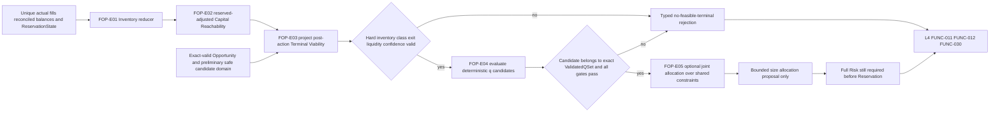

| Contract field | Functional meaning |
|---|---|
| Input / validation | Actual Inventory, available balance/book after claims, Graph/Atlas/exits, opportunity distributions and preliminary Risk-safe domain |
| Processing / decision | Reachability, projected terminal state, full candidate q curve and optional shared-resource allocation |
| Output / state effect | Inventory writer mutates only from actual facts; other stages emit viability/size/allocation proposals with no permission |
| Failure / fallback | Hard band/no exit/OOD/unsupported q/shared capacity yields rejection or q=0; `Q_validated` supremum is not membership proof |
| Versions / consumers | Account/Inventory/Reservation/Book/Graph/Atlas/model/capability/Risk config; full Risk and Reservations consume |
| Source / status | [Inventory/Capital](../../08_INVENTORY_AND_CAPITAL.md), [Sizing](../inventory-capital/06_POSITION_SIZING_VALIDATED_CAPACITY_AND_SEARCH.md); later Portfolio/Bridge scope remains capability-gated |

## 23. `ARCH-MAP-020` — Risk, Reservation and Execution functions

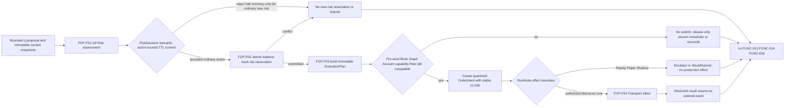

| Contract field | Functional meaning |
|---|---|
| Input / validation | Size proposal, immutable RiskSnapshot dependencies, exact capability/readiness and available shared resources |
| Processing / decision | Structured Risk action, atomic claims, immutable plan, pre-send T2 revalidation, intent/effect separation |
| Output / state effect | Risk/Reservation/Execution are separate writers; Transport performs mode-specific effect and returns observations |
| Failure / fallback | Hard reject, invalid `allowed/action`, missing open `RiskReservation` fields, conflict, expiry or stale state means no new-risk effect |
| Versions / consumers | Risk/account/inventory/reservation/book/graph/model/config/capability/plan/order; ordered reducers consume results |
| Source / status | [Risk](../../09_RISK_CONSTITUTION.md), [Execution](../../10_EXECUTION_STATE_MACHINE.md); ARCH-026/027 remain open and implementation unverified |

## 24. `ARCH-MAP-021` — Partial fill, Recovery and Reconciliation functions

```mermaid
flowchart LR
    O21["Ordered unique FillEvent or ambiguous order result"] --> K21{"Known unique actual fill"}
    K21 -->|yes| F21["FOP-F03 append FillLedger and consume reservation"]
    F21 --> I21["Inventory updates actual quantity fees and exposure"]
    I21 --> C21{"Actual quantity supports safe current continuation"}
    C21 -->|yes| P21["New versioned continuation proposal Risk reservation plan"]
    C21 -->|no| R21["FOP-F05 Recovery from current exposure"]
    K21 -->|possible send unresolved| U21["UNKNOWN; retain all affected claims"]
    U21 --> Q21["FOP-F06 query orders then fills then balances"]
    R21 --> Q21
    Q21 --> V21{"Reconciliation consistent"}
    V21 -->|no| H21["UNRESOLVED stop affected new risk and escalate"]
    V21 -->|yes| A21["Commit missing unique facts release proven remainder readiness reassessment"]
    A21 --> T21["L4 FUNC-015 FUNC-016 FUNC-017 FUNC-018 FUNC-019"]
    H21 --> T21
```

| Contract field | Functional meaning |
|---|---|
| Input / validation | Actual unique fills/order states, current exposure, reservations, books/rules and exchange query evidence |
| Processing / decision | Actual-fill-driven continuation, bounded Recovery and canonical reconciliation order `orders -> fills -> balances` |
| Output / state effect | Fill/Inventory/Execution/Recovery/Reconciliation owners update their families; original plan stays immutable evidence |
| Failure / fallback | Cancel race applies fill; timeout is `UNKNOWN`; no blind resend; unsafe/no exit remains locked or `RECOVERY_FAILED` |
| Versions / consumers | Fill/order/account/inventory/reservation/recovery/reconciliation/plan versions; Accounting/Risk/Ops consume |
| Source / status | [Execution](../../10_EXECUTION_STATE_MACHINE.md), [partial fills](../execution/07_PARTIAL_FILLS_DUST_AND_INTERMEDIATE_BUFFERS.md); five machines preserved, tests absent |

## 25. `ARCH-MAP-022` — Accounting functions and economic truth

```mermaid
flowchart LR
    F22["Unique actual FillLedger entries and actual fees"] --> C22["FOP-G01 classify action identity"]
    N22["Deposit withdrawal external transfer"] --> A22["Account and Inventory owners apply proven asset fact"]
    A22 --> CF22["Capital-flow record outside trading PnL"]
    M22["Point-in-time valuation event"] --> MT22["InventoryMTM record; no quantity mutation"]
    C22 --> B22{"Disjoint bucket"}
    B22 -->|Strategy| S22["Strategy record"]
    B22 -->|Recovery Rebalance Bridge| R22["Named action record"]
    S22 --> G22["QF-106 global close and scoped QF-108 reconciliation"]
    R22 --> G22
    CF22 --> G22
    MT22 --> G22
    G22 --> D22{"Stable entry already applied"}
    D22 -->|yes| X22["Idempotent no-op or reconciliation"]
    D22 -->|no| P22["Persist Accounting record with actual versus expected provenance"]
    P22 --> T22["L4 FUNC-020 FUNC-027"]
    X22 --> T22
```

| Contract field | Functional meaning |
|---|---|
| Input / validation | Reconciled fills/fees, action identity, external capital flows and point-in-time valuations with stable provenance |
| Processing / decision | Exact-once classification into disjoint buckets and QF-106/QF-108 scope reconciliation |
| Output / state effect | Accounting alone writes accounting records; Account/Inventory alone write quantities; prediction never becomes realized truth |
| Failure / fallback | Duplicate/conflicting entry opens reconciliation; deposit is not profit; MTM changes value but never units |
| Versions / consumers | Action/entry/fill/account/inventory/valuation/Formula versions; Ops/Validation/research consume read-only |
| Source / status | [Accounting deep spec](../inventory-capital/10_ECONOMIC_PNL_ACCOUNTING_AND_CAPITAL_EFFICIENCY.md), [Data non-trade flows](../../11_DATA_CONTRACTS.md#non-trade-balance-changes-and-valuation); serialized record schema remains Data-owned/open |

## 26. `ARCH-MAP-023` — Recorder, Replay and DecisionTrace functions

```mermaid
flowchart LR
    E23["Ordered RAW outcomes canonical transitions and P0 evidence"] --> H23["FOP-A07 bounded Recorder handoff"]
    H23 --> P23{"Priority and capacity"}
    P23 -->|P3 then P2 degradation| Q23["Explicit drops gaps and quality state"]
    P23 -->|P0 integrity threatened| S23["RecorderHealth stops new risk; safety paths remain"]
    P23 -->|accepted| W23["C4 write flush checksum rotate journal chunks"]
    W23 --> D23["Closed Dataset and RunManifest"]
    D23 --> R23["FOP-A08 isolated Replay ingress ReplayClock C0 state"]
    R23 --> X23["ReplayTransport emulator or disabled effects"]
    X23 --> C23["Canonical reducers produce DecisionTrace and state hashes"]
    C23 --> V23{"Repeat with same manifest and seed"}
    V23 -->|different| F23["Report first divergence; evidence invalid"]
    V23 -->|same| O23["Deterministic Replay evidence only"]
    O23 --> T23["L4 FUNC-021 FUNC-022 FUNC-025 FUNC-028"]
    Q23 --> T23
    S23 --> T23
    F23 --> T23
```

| Contract field | Functional meaning |
|---|---|
| Input / validation | Assigned ordered evidence, criticality class and complete point-in-time run identities |
| Processing / decision | Bounded enqueue versus background persistence/durability, manifest closure, isolated Replay with explicit Clock/RNG |
| Output / state effect | Recorder writes evidence state; Replay mutates only Replay-owned state and emits `DecisionTrace`/report |
| Failure / fallback | No silent loss/completeness claim; P0 threat stops new risk; sequence-before-durability crash stays explicit; Replay never calls Live Transport |
| Versions / consumers | Capture/schema/chunk/dataset/run/config/model/formula/seed; Validation/audit consume, Live admits only separately promoted artifacts |
| Source / status | [Recorder/Replay](../../12_RECORDER_AND_REPLAY.md), [priority](../recorder-replay/03_PRIORITY_BACKPRESSURE_AND_DATA_QUALITY.md); ARCH-019 durability implementation unproved |

## 27. `ARCH-MAP-024` — Capability, Validation and Deployment functions

```mermaid
flowchart LR
    E24["Immutable EvidenceIds including negative outcomes"] --> V24["FOP-G03 exact-scope Validation assessment"]
    V24 --> D24{"Required maturity and dependencies earned"}
    D24 -->|no| N24["No promotion; retain restriction or demotion"]
    D24 -->|yes| H24["Separate human approval"]
    H24 --> C24["FOP-G02 signed CapabilityManifest"]
    B24["Verified digest config license host and one owner"] --> P24["FOP-G05 botctl preflight startup sync reconcile"]
    P24 --> R24{"Current readiness established"}
    C24 --> I24{"Runtime authority intersection"}
    R24 --> I24
    L24["License and release scope"] --> I24
    K24["Current RiskDecision"] --> I24
    I24 -->|all exact operands valid| A24["Execution may consider bounded intent"]
    I24 -->|any absent stale or broader request| N24
    A24 --> T24["L4 FUNC-023 FUNC-024 FUNC-032"]
    N24 --> T24
```

| Contract field | Functional meaning |
|---|---|
| Input / validation | Immutable evidence, exact capability tuple, verified artifact/config/license/host, exclusive owner and reconciled runtime state |
| Processing / decision | M0–M5 assessment, explicit approval/manifest, non-ready startup and seven-way runtime intersection |
| Output / state effect | Validation/Capability/Deployment own evidence, promoted scope and lifecycle state; none writes economic truth or directly submits |
| Failure / fallback | Missing/stale evidence, license, ownership or reconciliation blocks new risk; cancel/Recovery/Reconciliation/read access remain per policy |
| Versions / consumers | Evidence/manifest/build/config/license/infra/readiness/Risk versions; Deployment/Risk/Execution/Ops consume |
| Source / status | [Validation](../../16_VALIDATION_MATRIX.md), [Deployment](../../14_DEPLOYMENT_AND_DOCKER.md); documentation specified, approval/implementation/capital absent |

## 28. Known open documentary boundaries

The atlas intentionally preserves these unresolved or review-scoped boundaries rather than drawing
an invented solution:

- the exact `RiskDecision.action` to compatibility-boolean mapping;
- the exact field-level `RiskReservation` schema;
- calibrated Recorder capacities, durability acknowledgment and failure deadlines;
- the ingress source-priority table and cross-recorder merge policy;
- implementation evidence for atomic Graph/Route generation publication;
- explicit Accounting record identity/version in the state-ownership inventory;
- current external exchange semantics, which require dated revalidation at implementation time.

These are inputs to future approved correction or implementation passes, not permissions created by
the diagrams.
