# Architecture Visual Atlas

`DOCUMENTATION STATUS: AWAITING HUMAN REVIEW`

This atlas is the maintained visual entry point for understanding how the system is intended to
work across domain, temporal, failure, evidence and operational boundaries. It supplements the
[Master Architecture](../../00_MASTER_ARCHITECTURE.md) and the owning domain contracts; it never
overrides them.

The diagrams describe documentary contracts. They are not implementation evidence, passed tests,
capability activation, Live permission or capital authorization.

## Atlas authority boundary

This is the sole **maintained cross-domain visual catalog**. It owns stable `ARCH-MAP-*`
identifiers, navigation and current explanatory renderings, but never the underlying domain
semantics. Masters and owning deep contracts remain authoritative. The F2 five-map atlas is a
candidate-specific review snapshot: it may link here for drill-down, but future diagrams are not
duplicated there and changes here do not retroactively certify or rewrite a selected F2 snapshot.

## 1. How to extend this atlas

Future architecture diagrams belong here when they explain a cross-domain flow or provide a
navigation view that is useful beyond one analysis pass.

1. Give each diagram a stable `ARCH-MAP-NNN` identifier and never renumber an existing map.
2. Add it to the catalog before adding the Mermaid source.
3. State its inputs, outputs, owner, dependencies, exceptional paths, authority and status.
4. Link to the owning contract instead of restating or silently changing domain truth.
5. Keep every arrow meaningful: data, event, command, effect, proposal, evidence or permission.
6. Keep optional, Later V1, Future and Research paths visually distinct from current V1.
7. Validate Mermaid syntax before merge when a compiler is available.

If a diagram and an owning contract disagree, the contract wins and the diagram must be corrected.
A semantic change to ownership, ordering, Risk, Execution truth or authorization still requires the
normal architecture and human-review process.

## 2. Map catalog

| Map ID | View | Primary authority | Scope |
|---|---|---|---|
| `ARCH-MAP-001` | Global system | Master Architecture; PASS 13 ownership contracts | Current V1 orientation |
| `ARCH-MAP-002` | Functional domains and state ownership | State and component ownership matrices | Current V1 orientation |
| `ARCH-MAP-003` | C0-C5 temporal architecture | Async concurrency and ordered commit | Current V1 plus isolated Research |
| `ARCH-MAP-004` | Failure propagation and containment | Risk, Recorder, Execution, Recovery/Reconciliation | Current V1 safety behavior |
| `ARCH-MAP-005` | Scientific maturity and operational authorization | Validation, Capability and F2 contracts | Evidence and permission boundary |
| `ARCH-MAP-006` | Book reconnect walkthrough | Data, Book, Graph, Capability and Risk | Operational walkthrough |
| `ARCH-MAP-007` | Graph generation change walkthrough | Graph/Routes and stale-result contracts | Operational walkthrough |
| `ARCH-MAP-008` | Recorder P0 failure walkthrough | Recorder, Risk and Reconciliation | Operational walkthrough |
| `ARCH-MAP-009` | Partial TT execution walkthrough | Execution, Inventory, Reservations and Accounting | Operational walkthrough |
| `ARCH-MAP-010` | Scientific candidate walkthrough | Falsifier, Validation and Capability | Scientific walkthrough |
| `ARCH-MAP-011` | Risk and Execution pipeline | Risk, Sizing, Reservations and Execution | Operational walkthrough |
| `ARCH-MAP-012` | Shared L2 liquidity and atomic capacity | Book, Sizing, Allocation and Reservations | Capacity walkthrough |
| `ARCH-MAP-013` | Favorable Simulator output refused by Risk | Simulator, Risk and Execution | Authorization walkthrough |
| `ARCH-MAP-014` | RAW identity, normalization outcome and ordered evidence | Data, Recorder, Async and Replay | Ingestion/evidence walkthrough |
| `ARCH-MAP-015` | Feed Adapter, Normalizer and Book functions | Data, Book and readiness contracts | Functional drill-down |
| `ARCH-MAP-016` | Metadata, Graph, Routes and reverse indexes | Graph/Routes and generation contracts | Functional drill-down |
| `ARCH-MAP-017` | NetConvert, Formula and Opportunity functions | Formula Book and Opportunity contracts | Functional drill-down |
| `ARCH-MAP-018` | Features, Participants and Simulator functions | Quant, Participants and Simulator contracts | Functional drill-down |
| `ARCH-MAP-019` | Inventory, Reachability, Terminal and Sizing functions | Inventory/Capital and Risk contracts | Functional drill-down |
| `ARCH-MAP-020` | Risk, Reservation and Execution functions | Risk and Execution contracts | Functional drill-down |
| `ARCH-MAP-021` | Partial fill, Recovery and Reconciliation functions | Execution, Inventory and Risk contracts | Functional drill-down |
| `ARCH-MAP-022` | Accounting functions and economic truth | Accounting, Formula and Data contracts | Functional drill-down |
| `ARCH-MAP-023` | Recorder, Replay and DecisionTrace functions | Data, Recorder and Replay contracts | Functional drill-down |
| `ARCH-MAP-024` | Capability, Validation and Deployment functions | Validation, Deployment and Risk contracts | Functional drill-down |
| `ARCH-MAP-025` | Ordered Event Coordinator commit decision | Async/Data ordered-commit contracts | Detailed operation; parent `ARCH-MAP-015` |
| `ARCH-MAP-026` | Recorder priority, persistence and durability | Recorder/Data/Infra contracts | Detailed operation; parent `ARCH-MAP-023` |
| `ARCH-MAP-027` | Replay reconstruction and determinism | Recorder/Replay/Data contracts | Detailed operation; parent `ARCH-MAP-023` |
| `ARCH-MAP-028` | Book reducer and readiness publication | Book/Data/Graph contracts | Detailed operation; parent `ARCH-MAP-015` |
| `ARCH-MAP-029` | Graph generation atomic publication | Graph/Route/index contracts | Detailed operation; parent `ARCH-MAP-016` |
| `ARCH-MAP-030` | NetConvert exact economic computation | Formula QF-007–016 contracts | Detailed operation; parent `ARCH-MAP-017` |
| `ARCH-MAP-031` | Position Sizer validated-set search | Inventory/Capital/Risk contracts | Detailed operation; parent `ARCH-MAP-019` |
| `ARCH-MAP-032` | Risk snapshot and action decision | Risk/Data contracts | Detailed operation; parent `ARCH-MAP-020` |
| `ARCH-MAP-033` | Atomic Reservation lifecycle | Execution/Inventory/Risk contracts | Detailed operation; parent `ARCH-MAP-020` |
| `ARCH-MAP-034` | Execution Coordinator state transition | Execution five-machine contracts | Detailed operation; parent `ARCH-MAP-020` |
| `ARCH-MAP-035` | Execution Transport effect and response | Execution/Data/RunMode contracts | Detailed operation; parent `ARCH-MAP-020` |
| `ARCH-MAP-036` | Recovery planning and bounded execution | Recovery/Risk/Inventory contracts | Detailed operation; parent `ARCH-MAP-021` |
| `ARCH-MAP-037` | Reconciliation proof and readiness | Reconciliation/Account/Data contracts | Detailed operation; parent `ARCH-MAP-021` |

## 3. `ARCH-MAP-001` — Global system

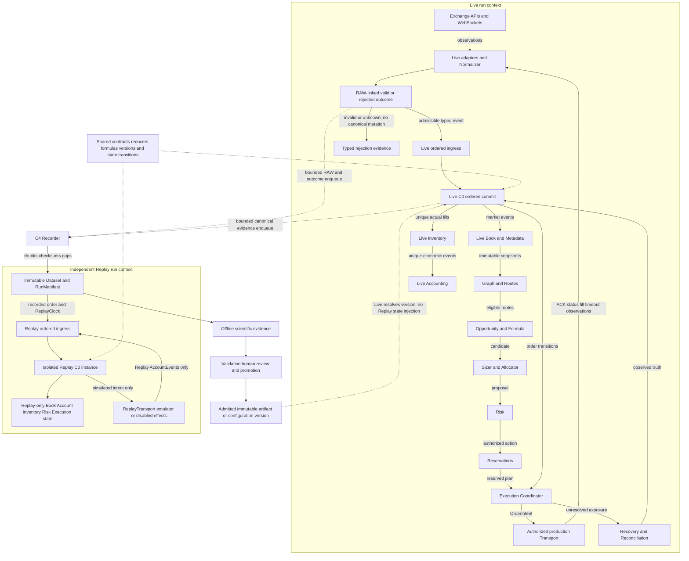

| Field | Meaning |
|---|---|
| Inputs | Exchange market, metadata, account, order and fill observations |
| Outputs | Live canonical/economic state, isolated Replay state, effect intents and durable evidence |
| Owner | Ordered domain reducers; the ordered boundary sequences commits but is not a second writer |
| Dependencies | Data versions, Book readiness, Graph generation, Formula, Risk, Reservations and Capability |
| Exceptional paths | Stale/unknown state stops affected new risk; transport results return as events; Recorder handoff stays bounded; Replay cannot target Live state/Transport |
| Authority | [Master Architecture](../../00_MASTER_ARCHITECTURE.md), [state ownership](../../_analysis/pass13_master_architecture/STATE_OWNERSHIP_MATRIX.md), [command/event ownership](../../_analysis/pass13_master_architecture/EVENT_AND_COMMAND_OWNERSHIP_MATRIX.md) |
| Status | Intended current V1 architecture; implementation not verified |

No adapter, transport callback, Recorder, model or operator command may directly mutate economic
truth owned by another reducer. Live and Replay reuse the same implementation semantics but never
the same mutable Account, Inventory, Reservation, Execution or Risk state.

## 4. `ARCH-MAP-002` — Functional domains and state ownership

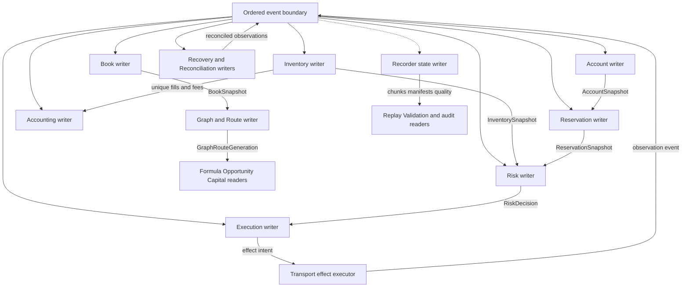

| Field | Meaning |
|---|---|
| Inputs | Ordered observations, bounded capture/health events and immutable versioned snapshots |
| Outputs | One canonical state version per logical owner |
| Owner | Each named domain is sole logical writer for its state family |
| Dependencies | Ordered event boundary, exact versions and authoritative return events |
| Exceptional paths | Stale or contradictory input is rejected, revalidated or fails closed |
| Authority | [Architecture ownership deep spec](03_STATE_OWNERSHIP_EVENTS_COMMANDS_AND_EFFECTS.md), [component ownership](../../_analysis/pass13_master_architecture/COMPONENT_OWNERSHIP_MATRIX.md) |
| Status | Ownership contract documented; implementation not verified |

Accounting consumes unique actual economic events. It does not write Inventory, and Inventory does
not write Accounting records.

## 5. `ARCH-MAP-003` — Temporal architecture and C0-C5 boundaries

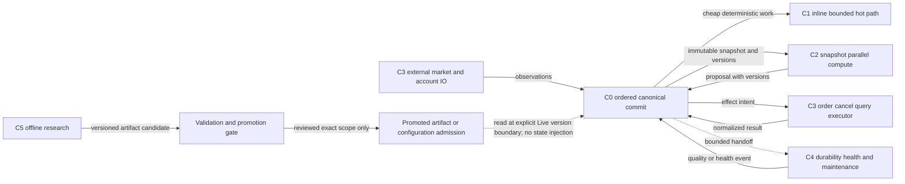

| Field | Meaning |
|---|---|
| Inputs | External observations, immutable snapshots, effect intents and research artifacts |
| Outputs | Ordered commits, bounded proposals, effect results, evidence and reviewed artifacts |
| Owner | C0 domain owners commit; C1-C5 do not create independent economic truth |
| Dependencies | Bounded queues, version checks, deadlines, stale-result rejection and explicit promotion |
| Exceptional paths | First-worker-wins, direct worker mutation, research-to-order and indefinite disk/network waits are forbidden |
| Authority | [Async Concurrency and Ordered Commit](14_ASYNC_CONCURRENCY_AND_ORDERED_COMMIT.md), [async system map](../../_analysis/async_concurrency_architecture/ASYNC_SYSTEM_MAP.md) |
| Status | Responsibility classes specified; runtime scheduling and capacity remain implementation/calibration work |

The governing rule is: **parallel to calculate, ordered to decide, single-writer to commit**.

## 6. `ARCH-MAP-004` — Failure propagation and containment

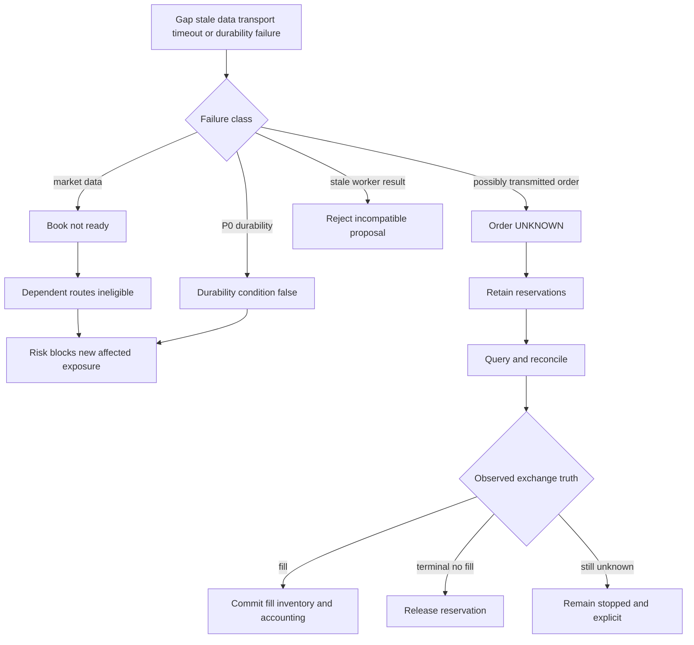

| Field | Meaning |
|---|---|
| Inputs | Data gaps, stale versions, durability loss, timeouts and worker completions |
| Outputs | Scoped non-readiness, blocked new risk, retained reservations, reconciliation or explicit unresolved state |
| Owner | Data/Book for readiness, Risk for permission, Execution for order lifecycle, Reconciliation for observed truth |
| Dependencies | Current state versions, unique fills, P0 evidence and recoverable query paths |
| Exceptional paths | Stopping new risk never suppresses an already observed fill or disables safe Recovery/Reconciliation |
| Authority | [Failure containment](11_FAILURE_CONTAINMENT_AND_DEGRADATION_ARCHITECTURE.md), [Risk](../../09_RISK_CONSTITUTION.md), [Execution](../../10_EXECUTION_STATE_MACHINE.md) |
| Status | Safety behavior specified; implementation and fault-injection evidence absent |

## 7. `ARCH-MAP-005` — Scientific maturity and operational authorization

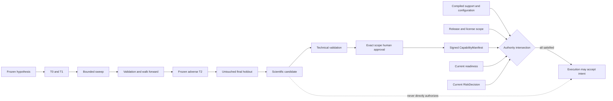

| Field | Meaning |
|---|---|
| Inputs | Frozen hypothesis, point-in-time evidence, technical evidence, manifest and current runtime state |
| Outputs | Scientific disposition, exact-scope capability evidence, or runtime ineligibility |
| Owner | Validation owns evidence; human authority owns approval; Capability owns manifest; Risk owns current permission |
| Dependencies | No-lookahead protocol, maturity evidence, support/config/license/readiness and current Risk |
| Exceptional paths | Scientific success cannot directly create an order, validated q, capital permission or Live promotion |
| Authority | [RunModes and capability](09_RUNMODES_CAPABILITY_ACTIVATION_AND_VALIDATION.md), [Build/Validate/Scale](../../19_BUILD_VALIDATE_SCALE_ROADMAP.md), [F2 lifecycle](../validation/14_ROBUST_REGION_AND_CANDIDATE_LIFECYCLE.md) |
| Status | F2 scientific path proposed; approval, implementation and capital remain separate |

## 8. `ARCH-MAP-006` — Book reconnect walkthrough

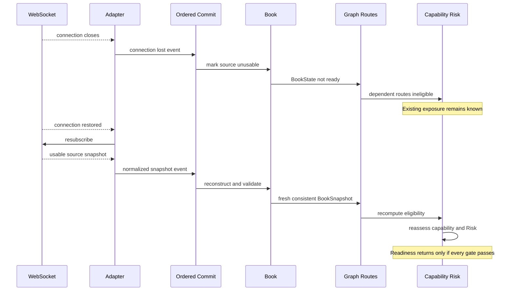

Ordinary path: a valid snapshot restores the Book before route eligibility and safety gates are
reassessed. Failure path: a connected socket without a usable snapshot remains non-ready.

State owners: Adapter owns connection observations; Book owns `BookState`; Graph owns route
eligibility; Capability and Risk own their respective gates.

Authority: [Data Contracts](../../11_DATA_CONTRACTS.md), [Recorder/Replay](../../12_RECORDER_AND_REPLAY.md),
[Market-to-decision pipeline](05_MARKET_TO_DECISION_PIPELINE.md).

## 9. `ARCH-MAP-007` — Graph generation change walkthrough

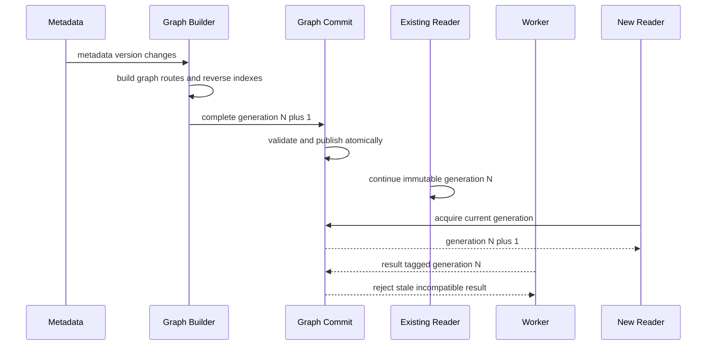

Ordinary path: topology, route definitions and reverse indexes become reader-visible as one
compatible immutable generation. Failure path: an incomplete or incompatible build is not
published; readers continue using the previous generation.

State owner: Graph/Route writer only. Workers build proposals and never publish independently.

Authority: [Graph and Routes](../../03_MARKET_GRAPH_AND_ROUTES.md), [route precomputation](../market-graph/04_ROUTE_PRECOMPUTATION_PAIR_TO_ROUTES_AND_INVALIDATION.md),
[stale-result contract](../../_analysis/async_concurrency_architecture/STALE_RESULT_AND_VERSIONING_CONTRACT.md).

## 10. `ARCH-MAP-008` — Recorder P0 failure walkthrough

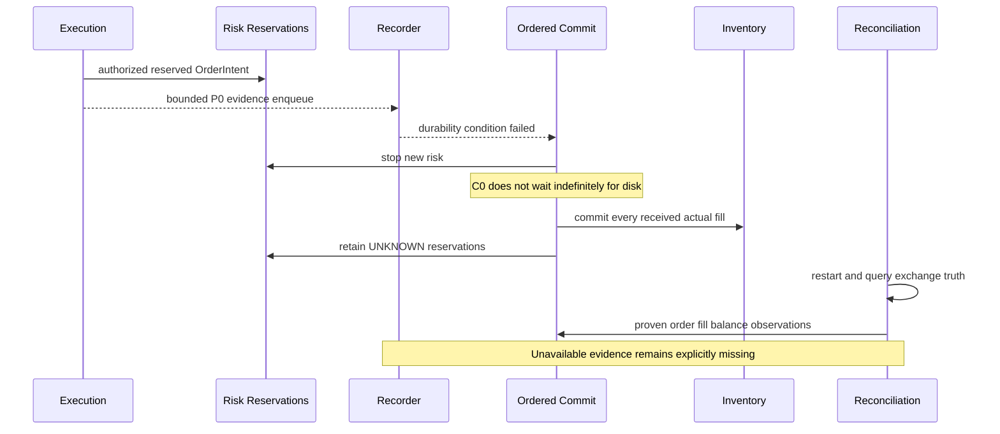

Specified behavior: Recorder handoff is bounded; failure of required durability stops new risk;
received fills still update actual economic state; UNKNOWN retains reservations; restart uses
reconciliation rather than invented evidence.

Implementation details still requiring design or calibration include acknowledgment semantics,
emergency buffers, flush/fsync policy, deadlines, queue capacity and crash consistency.

Authority: [Recorder/Replay](../../12_RECORDER_AND_REPLAY.md), [Recorder priority matrix](../../_analysis/pass06_data_recorder_replay/RECORDER_PRIORITY_AND_BACKPRESSURE_MATRIX.md),
[Execution/Recovery pipeline](06_EXECUTION_RECOVERY_AND_RECONCILIATION_PIPELINE.md).

## 11. `ARCH-MAP-009` — Partial TT execution walkthrough

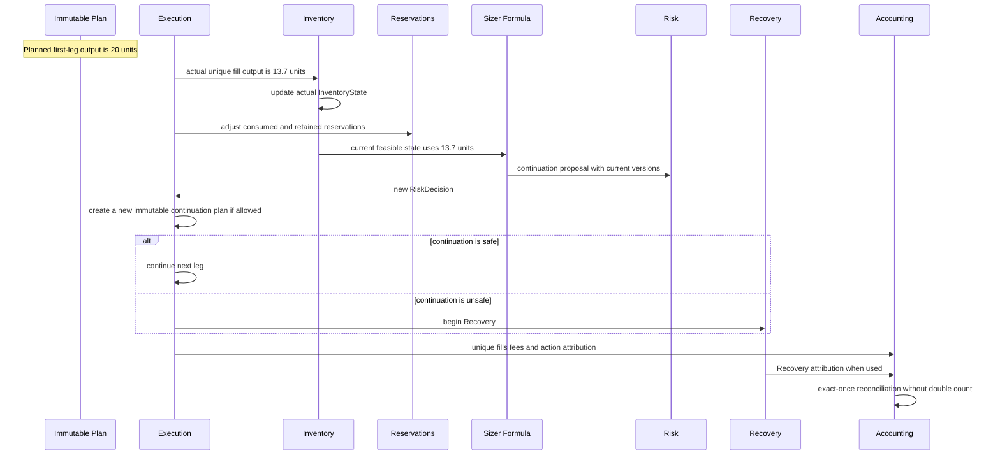

The original plan remains immutable evidence. Actual 13.7-unit state, not planned 20-unit output,
drives the next sizing, Risk and Execution decision. Recovery cannot bypass Risk, and Accounting
cannot fabricate or duplicate exposure.

Authority: [Execution State Machine](../../10_EXECUTION_STATE_MACHINE.md), [Inventory and Capital](../../08_INVENTORY_AND_CAPITAL.md),
[Risk](../../09_RISK_CONSTITUTION.md), [accounting reconciliation](../../_analysis/corr05_economic_integration/ACCOUNTING_RECONCILIATION_MAP.md).

## 12. `ARCH-MAP-010` — Scientific candidate walkthrough

```mermaid
flowchart LR
    H["1 Fixed hypothesis"] --> F["2 Frozen experiment"]
    F --> T01["3 T0 and T1"]
    T01 --> S["4 Bounded sweep"]
    S --> V["5 Validation and walk forward"]
    V --> T2["6 Frozen adverse T2"]
    T2 --> HO["7 Untouched holdout"]
    HO --> C["8 Scientific candidate"]
    C --> TV["9 Separate technical validation"]
    TV --> HA["10 Exact scope human approval"]
    HA --> I["11 Capability readiness and Risk intersection"]
    I --> O["Execution eligibility"]
    C -.->|no direct authority| O
```

Failure at any scientific stage produces a negative, inconclusive or invalid result that remains in
the evidence record. Holdout success does not grant implementation, Shadow, Live, capital or order
permission.

Research/Validation own experiments and candidate evidence; Capability owns the exact manifest;
Risk owns current permission; Execution alone creates `OrderIntent` after every gate is satisfied.

Authority: [Economic Falsifier](../validation/13_ECONOMIC_FALSIFIER_AND_BOUNDED_SWEEP.md), [candidate lifecycle](../validation/14_ROBUST_REGION_AND_CANDIDATE_LIFECYCLE.md),
[Validation Matrix](../../16_VALIDATION_MATRIX.md).

## 13. `ARCH-MAP-011` — Risk and Execution pipeline

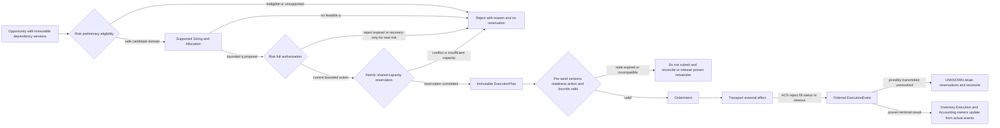

| Field | Meaning |
|---|---|
| Purpose | Show the single Risk authority at preliminary and full checkpoints without treating either checkpoint as a Submit command |
| Inputs | Versioned Opportunity, Book/Graph/Account/Inventory snapshots, supported model outputs and current capability/readiness |
| Outputs | Reject reason, bounded `RiskDecision`, reservation, immutable plan, `OrderIntent` or ordered result event |
| Owner | Risk owns both Risk checkpoints; Sizing proposes q; Reservations own claims; Execution owns plan/order lifecycle; Transport performs effects |
| Decisions / errors | Unsupported model, no feasible q, Risk rejection, reservation conflict, expiry/staleness and `UNKNOWN` all fail closed for new risk |
| Version / freshness | Full authorization and pre-send checks require current compatible versions; an early eligibility check never substitutes for them |
| Authority | [Risk](../../09_RISK_CONSTITUTION.md), [Execution](../../10_EXECUTION_STATE_MACHINE.md), [decision pipeline](../../_analysis/pass13_master_architecture/DECISION_PIPELINE_MAP.md) |
| Related | `ARCH-006`, `ARCH-009`, `ARCH-024`, `ARCH-026`, `ARCH-027`; A-05, A-07, A-16–A-18, A-23 |
| Status | Documentary ordering clarified; exact `allowed`/`action` compatibility and field-level `RiskReservation` schema remain OPEN human/source decisions; implementation not verified |

## 14. `ARCH-MAP-012` — Two routes share L2 liquidity

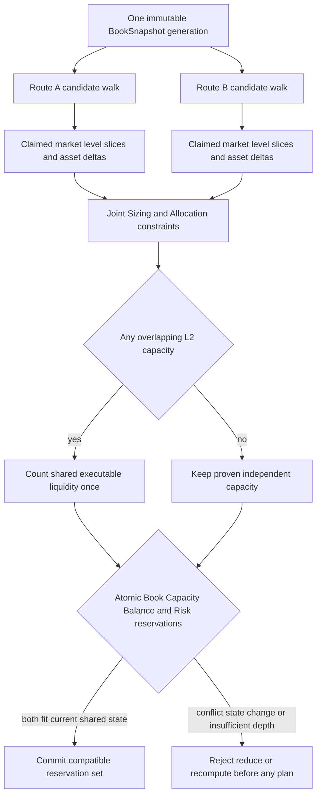

Illustrative example: two apparent opportunities reference the same executable book level. Their
standalone quantities may each look feasible, but the common units are available only once. The
Allocator and Reservation owners must compare both against one current shared-capacity state; no
sum of standalone simulations may manufacture extra depth.

| Field | Meaning |
|---|---|
| Purpose | Make A-19 and the no-double-reservation rule visible |
| Inputs | Immutable Book versions, per-route depth dependencies, candidate q and existing reservations |
| Outputs | Compatible atomic reservation set, reduced/recomputed candidates or rejection |
| Owner | Book owns observed depth; Sizing/Allocation owns joint proposal; Reservations own the atomic capacity claim |
| Decisions / errors | Overlap, stale generation, competing claim or insufficient observed depth prevents double use |
| Version / freshness | Every claim carries compatible Book/Graph/route/account/risk versions and is revalidated before effect |
| Authority | [Graph and Routes](../../03_MARKET_GRAPH_AND_ROUTES.md), [Inventory and Capital](../../08_INVENTORY_AND_CAPITAL.md), [Execution](../../10_EXECUTION_STATE_MACHINE.md) |
| Related | `ARCH-009`, `ARCH-014`, `ARCH-027`; A-07, A-18, A-19 |
| Status | Documentary capacity semantics; numerical allocator/search policy and implementation tests remain unverified |

## 15. `ARCH-MAP-013` — Simulator says profitable, Risk refuses

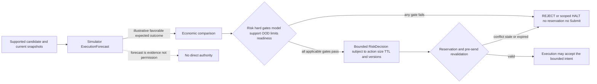

Illustrative example: a forecast can show positive expected economics while a hard inventory
limit, unsupported q band, OOD model state, stale dependency or readiness failure causes Risk to
refuse new exposure. Positive model output is never converted into permission or capital.

| Field | Meaning |
|---|---|
| Purpose | Separate model/economic evidence from Risk sovereignty and effect authorization |
| Inputs | `ExecutionForecast`, economic output, model support/OOD evidence, current snapshots, readiness and capability |
| Outputs | Reject/halt reason or a bounded current `RiskDecision`; never a direct Simulator order |
| Owner | Simulator owns forecast; Formula owns economics; Risk owns permission; Reservations/Execution own later stages |
| Decisions / errors | Unsupported/OOD model, hard-gate failure, stale decision, reservation conflict or pre-send mismatch prevents Submit |
| Version / freshness | Forecast support, q band, state/config/model versions, TTL and pre-send state must remain compatible |
| Authority | [Simulator](../../07_COUNTERFACTUAL_SIMULATOR.md), [Risk](../../09_RISK_CONSTITUTION.md), [model execution risk](../risk/04_MODEL_EXECUTION_AND_TAIL_RISK.md) |
| Related | `ARCH-006`, `ARCH-024`, `ARCH-025`, `ARCH-026`; A-05, A-08, A-11, A-12, A-14, A-23 |
| Status | Documentary refusal path clarified; model calibration, support evidence and implementation remain unverified |

## 16. `ARCH-MAP-014` — RAW identity, normalization outcome and ordered evidence

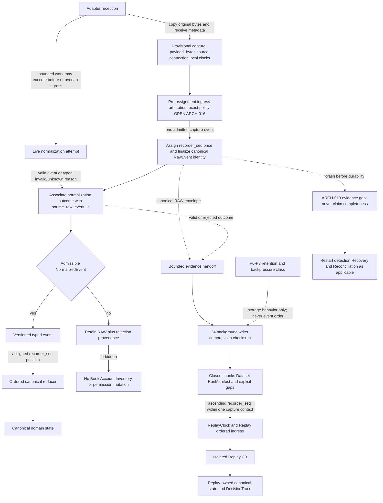

The arrows show required data dependencies and ownership, not a mandatory total physical schedule.
In particular, bounded normalization may run before or overlap ingress; the valid/rejected outcome
becomes usable only after association with the finalized RAW identity. What is fixed is one
`recorder_seq` assignment per admitted capture event, immutable post-assignment order, evidence for
both success and rejection, ordered application of valid events, and background persistence that
cannot create another sequence authority.

| Field | Meaning |
|---|---|
| Purpose | Explain how an invalid or unknown payload remains ordered RAW evidence even though no valid event reaches a reducer |
| Inputs | Original source bytes, source/connection identity, local receive clocks and versioned normalization rules |
| Outputs | Final `RawEvent`, valid `NormalizedEvent` or typed rejection, bounded persistence handoff, Dataset/RunManifest and isolated Replay input |
| Owner | Data owns schema/ordering; ingress assigns `recorder_seq`; domain reducers own state; Recorder owns durability; Replay owns its independent run state |
| Decisions / errors | Exact pre-assignment arbitration and cross-recorder merge remain OPEN; invalid/unknown input cannot mutate state or fabricate a type |
| Version / freshness | Capture context, RAW/normalization schema, source connection, dataset/run manifest and Replay versions remain explicit |
| Exceptional paths | Writer priority/completion never reorders; a crash after assignment creates an explicit gap and invokes the ARCH-019 safety/reconciliation boundary |
| Authority | [Data Contracts](../../11_DATA_CONTRACTS.md), [Recorder/Replay](../../12_RECORDER_AND_REPLAY.md), [Event Ordering](../../_analysis/pass06_data_recorder_replay/EVENT_ORDERING_CONTRACT.md), [Async map](../../_analysis/async_concurrency_architecture/ASYNC_SYSTEM_MAP.md) |
| Related | `ARCH-001`, `ARCH-003`, `ARCH-016`–`ARCH-021`; RAW-ORDER-01–07 and REPLAY-ISO-01–04 |
| Status | Documentary lifecycle specified; acceptance/runtime/durability tests NOT EXECUTED; implementation not verified |

## 17. Functional navigation contract

`ARCH-MAP-015..024` are the maintained module-level functional drill-down layer for Prompt 2, and
`ARCH-MAP-025..037` are the selected detailed-operation layer. They use
documentary operation IDs from the functional correction report until an implementation exists;
they do not assert Rust symbol names. Each map exposes the same navigation chain:

`L0 system context -> L1 domain -> L2 module/interface -> L3 documented operation -> L4 contract/acceptance scenario`.

The authoritative component and producer/consumer inventories remain the PASS 13
[Component Catalog](../../_analysis/pass13_master_architecture/COMPONENT_CATALOG.md) and
[Domain Interface Catalog](../../_analysis/pass13_master_architecture/DOMAIN_INTERFACE_CATALOG.md).
The [Prompt 2 functional report](../../_analysis/f2_final_integration/PROMPT2_FUNCTIONAL_ARCHITECTURE_CORRECTION_REPORT.md)
provides the complete operation and `FUNC-*` traceability matrices without becoming a domain
authority. A later implementation review may attach verified source symbols to these stable
documentary operations; it must not silently replace their owning contracts.

<a id="arch-map-015"></a>
## 18. `ARCH-MAP-015` — Feed Adapter, Normalizer and Book functions

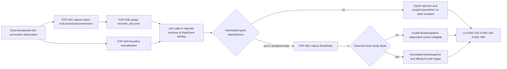

| Contract field | Functional meaning |
|---|---|
| Input / validation | Original bytes, source/connection clocks and schema; unknown/invalid input is retained but cannot mutate Book |
| Processing / decision | One ingress sequence, ordered reducer, snapshot invariants and distinct `CONNECTED -> ... -> BOOK_VALID` readiness |
| Output / state effect | `RawEvent`, typed event or rejection, then one Book-writer mutation and immutable `BookSnapshot` |
| Failure / fallback | Reject/quarantine invalid scope; gap/stale/crossed state invalidates the affected Book until snapshot/resync |
| Versions / consumers | RAW/normalization schema, connection, `recorder_seq`, Book/metadata versions; Graph/Features/Opportunity/Risk consume |
| Source / status | [Data Contracts](../../11_DATA_CONTRACTS.md), [Data schemas](../data/02_RAW_NORMALIZED_AND_DOMAIN_EVENT_SCHEMAS.md); specified, implementation tests absent |

<a id="arch-map-016"></a>
## 19. `ARCH-MAP-016` — Metadata, Graph, Routes and `pair_to_routes`

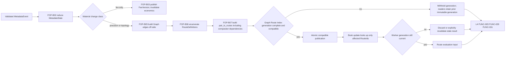

| Contract field | Functional meaning |
|---|---|
| Input / validation | Point-in-time metadata/status/precision; invalid or contradictory material metadata disables affected conversions |
| Processing / decision | Two directed edges per eligible market, deterministic fixed-route enumeration and reverse-index build |
| Output / state effect | Sole Graph/Route writer publishes one coherent immutable Graph/Route/index generation |
| Failure / fallback | No mixed generation; previous readers may finish on the old generation; stale worker cannot commit |
| Versions / consumers | Metadata, Graph, Route and index generation; Opportunity/Execution/Replay consume stable canonical IDs |
| Source / status | [Graph master](../../03_MARKET_GRAPH_AND_ROUTES.md), [precomputation](../market-graph/04_ROUTE_PRECOMPUTATION_PAIR_TO_ROUTES_AND_INVALIDATION.md); specified, implementation atomicity unverified |

<a id="arch-map-017"></a>
## 20. `ARCH-MAP-017` — NetConvert, Formula and Opportunity functions

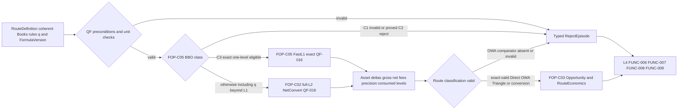

| Contract field | Functional meaning |
|---|---|
| Input / validation | Exact q/asset units, directed side, observed protected L2, point-in-time fee/precision/minimum and coherent versions |
| Processing / decision | QF-009/010 walk, QF-014/015 fee, QF-016 result; FastL1 changes traversal only and otherwise falls back |
| Output / state effect | Pure `RouteEconomics`, Opportunity or typed rejection; no Book, Inventory, Risk or order mutation |
| Failure / fallback | Insufficient depth, unknown rule, invalid minimum/precision or missing fair OWA comparator rejects; no invented liquidity |
| Versions / consumers | Book/Graph/Route/metadata/fee/precision/Formula/q; Opportunity/Sizer/Risk/evidence consume |
| Source / status | [Formula Book](../../04_FORMULA_BOOK.md), [Opportunity economics](../market-graph/05_OPPORTUNITY_DETECTION_AND_SIZE_DEPENDENT_ECONOMICS.md); QF unchanged, implementation parity unverified |

<a id="arch-map-018"></a>
## 21. `ARCH-MAP-018` — Features, Participants and Simulator functions

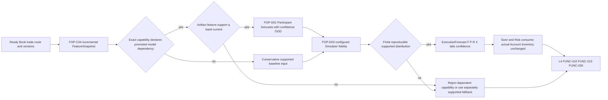

| Contract field | Functional meaning |
|---|---|
| Input / validation | Point-in-time `FeatureSnapshot`, candidate/q, artifact support, feed fidelity, model/fidelity/config and explicit seed where stochastic |
| Processing / decision | Bounded inference then one configured Simulator; F0/F1 baseline may omit advanced models, F4 remains offline Research |
| Output / state effect | Forecasts and `ExecutionForecast`; model/Simulator state only, never actual Fill/Account/Inventory truth or permission |
| Failure / fallback | Missing/OOD/stale model blocks only dependent scope; supported conservative fallback carries its own validation envelope |
| Versions / consumers | Feature/model/formula/book/route/config/fidelity/seed; Simulator, Sizer, Risk, Atlas and Validation consume |
| Source / status | [Participants](../../06_MARKET_PARTICIPANTS.md), [Simulator](../../07_COUNTERFACTUAL_SIMULATOR.md); specified, model calibration/implementation not established |

<a id="arch-map-019"></a>
## 22. `ARCH-MAP-019` — Inventory, Reachability, Terminal and Sizing functions

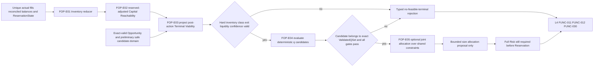

| Contract field | Functional meaning |
|---|---|
| Input / validation | Actual Inventory, available balance/book after claims, Graph/Atlas/exits, opportunity distributions and preliminary Risk-safe domain |
| Processing / decision | Reachability, projected terminal state, full candidate q curve and optional shared-resource allocation |
| Output / state effect | Inventory writer mutates only from actual facts; other stages emit viability/size/allocation proposals with no permission |
| Failure / fallback | Hard band/no exit/OOD/unsupported q/shared capacity yields rejection or q=0; `Q_validated` supremum is not membership proof |
| Versions / consumers | Account/Inventory/Reservation/Book/Graph/Atlas/model/capability/Risk config; full Risk and Reservations consume |
| Source / status | [Inventory/Capital](../../08_INVENTORY_AND_CAPITAL.md), [Sizing](../inventory-capital/06_POSITION_SIZING_VALIDATED_CAPACITY_AND_SEARCH.md); later Portfolio/Bridge scope remains capability-gated |

<a id="arch-map-020"></a>
## 23. `ARCH-MAP-020` — Risk, Reservation and Execution functions

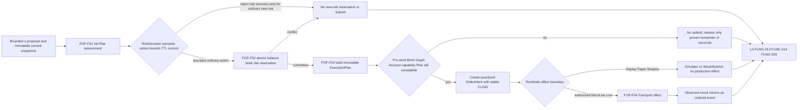

| Contract field | Functional meaning |
|---|---|
| Input / validation | Size proposal, immutable RiskSnapshot dependencies, exact capability/readiness and available shared resources |
| Processing / decision | Structured Risk action, atomic claims, immutable plan, pre-send T2 revalidation, intent/effect separation |
| Output / state effect | Risk/Reservation/Execution are separate writers; Transport performs mode-specific effect and returns observations |
| Failure / fallback | Hard reject, invalid `allowed/action`, missing open `RiskReservation` fields, conflict, expiry or stale state means no new-risk effect |
| Versions / consumers | Risk/account/inventory/reservation/book/graph/model/config/capability/plan/order; ordered reducers consume results |
| Source / status | [Risk](../../09_RISK_CONSTITUTION.md), [Execution](../../10_EXECUTION_STATE_MACHINE.md); ARCH-026/027 remain open and implementation unverified |

<a id="arch-map-021"></a>
## 24. `ARCH-MAP-021` — Partial fill, Recovery and Reconciliation functions

```mermaid
flowchart LR
    O21["Ordered FillEvent or ambiguous order result"] --> K21{"Observation proves an actual FillEvent"}
    K21 -->|yes| D21{"Stable FillId already accepted"}
    D21 -->|yes duplicate| X21["Idempotent no-op; no second lifecycle inventory reservation or accounting mutation"]
    D21 -->|no| L21["Account/Fill owner appends canonical unique FillLedger evidence"]
    L21 --> E21["FOP-F03 Execution Coordinator updates only its five-machine lifecycle"]
    L21 --> I21["FOP-E01 Inventory owner applies actual quantity fee and exposure delta"]
    L21 --> S21["FOP-F02 Reservation owner consumes used claim and retains unresolved remainder"]
    L21 -.-> A21["FOP-G01 Accounting consumes the attributed fact once"]
    E21 --> C21{"Owner snapshots committed and actual quantity supports safe current continuation"}
    I21 --> C21
    S21 --> C21
    C21 -->|yes| P21["New proposal then FOP-F01 Risk FOP-F02 Reservation and FOP-F03 immutable plan"]
    C21 -->|no| R21["FOP-F05 Recovery from current exposure"]
    K21 -->|possible send unresolved| U21["UNKNOWN; retain all affected claims"]
    U21 --> Q21["FOP-F06 query orders then fills then balances"]
    R21 --> Q21
    Q21 --> V21{"Reconciliation consistent"}
    V21 -->|no| H21["UNRESOLVED stop affected new risk and escalate"]
    V21 -->|yes| Y21["Route missing unique facts through their owners; release only proven remainder; reassess readiness"]
    Y21 --> T21["L4 FUNC-015 FUNC-016 FUNC-017 FUNC-018 FUNC-019"]
    X21 --> T21
    A21 --> T21
    H21 --> T21
```

| Contract field | Functional meaning |
|---|---|
| Input / validation | Actual unique fills/order states, current exposure, reservations, books/rules and exchange query evidence |
| Processing / decision | Account/Fill dedupe accepts each stable fill once; Execution, Inventory and Reservation then commit only their own families; continuation uses actual fills; Recovery and reconciliation retain canonical `orders -> fills -> balances` proof order |
| Output / state effect | FillLedger is owned by Account/Fill reducers; FOP-F03 owns only the five Execution machines; Inventory, Reservation, Recovery and Reconciliation retain distinct writers; Accounting consumes attributed facts |
| Failure / fallback | Duplicate fill is a complete mutation no-op; partial fill uses actual quantity; cancel race still applies a new fill; timeout is `UNKNOWN`; no blind resend or unproved release |
| Versions / consumers | Fill/order/account/execution/inventory/reservation/recovery/reconciliation/plan and accounting-entry versions; Risk/Ops consume immutable snapshots |
| Source / status | [Execution](../../10_EXECUTION_STATE_MACHINE.md), [partial fills](../execution/07_PARTIAL_FILLS_DUST_AND_INTERMEDIATE_BUFFERS.md); five machines preserved, tests absent |

<a id="arch-map-022"></a>
## 25. `ARCH-MAP-022` — Accounting functions and economic truth

```mermaid
flowchart LR
    F22["Unique actual FillLedger entries and actual fees"] --> C22["FOP-G01 classify action identity"]
    N22["Deposit withdrawal external transfer"] --> A22["Account and Inventory owners apply proven asset fact"]
    A22 --> CF22["Capital-flow record outside Strategy Recovery Rebalance Bridge trading PnL"]
    CF22 --> E22["QF-107 external-flow adjustment for balance equity and MTM reconciliation; never alpha"]
    M22["Point-in-time valuation event plus held quantity"] --> MT22["QF-107 InventoryMTM record net of identified ExternalFlow; no quantity mutation"]
    C22 --> B22{"Disjoint bucket"}
    B22 -->|Strategy| S22["Strategy record"]
    B22 -->|Recovery Rebalance Bridge| R22["Named action record"]
    S22 --> G22["QF-106 global economic close; QF-108 strategy subtotal only in its declared scope"]
    R22 --> G22
    MT22 --> G22
    E22 --> Q22["Account equity and capital-flow reconciliation outside PnL components"]
    G22 --> D22{"Stable accounting entry already applied"}
    Q22 --> D22
    D22 -->|yes| X22["Idempotent no-op or reconciliation"]
    D22 -->|no| P22["Persist Accounting record with actual versus expected provenance"]
    P22 --> T22["L4 FUNC-020 FUNC-027"]
    X22 --> T22
```

| Contract field | Functional meaning |
|---|---|
| Input / validation | Reconciled fills/fees, action identity, external capital flows and point-in-time valuations with stable provenance |
| Processing / decision | Exact-once classification into disjoint trading buckets; QF-107 removes identified external flows from valuation change; QF-106 closes global economics and QF-108 remains its source-scoped strategy subtotal |
| Output / state effect | Accounting alone writes accounting records; Account/Inventory alone write quantities; prediction never becomes realized truth |
| Failure / fallback | Duplicate/conflicting entry opens reconciliation; deposit/withdrawal/transfer affects holdings/equity but never StrategyPnL; MTM changes value but never units; each economic fact is counted once |
| Versions / consumers | Action/entry/fill/account/inventory/valuation/Formula versions; Ops/Validation/research consume read-only |
| Source / status | [Accounting deep spec](../inventory-capital/10_ECONOMIC_PNL_ACCOUNTING_AND_CAPITAL_EFFICIENCY.md), [Data non-trade flows](../../11_DATA_CONTRACTS.md#non-trade-balance-changes-and-valuation); serialized record schema remains Data-owned/open |

<a id="arch-map-023"></a>
## 26. `ARCH-MAP-023` — Recorder, Replay and DecisionTrace functions

```mermaid
flowchart LR
    E23["Ordered RAW outcomes canonical transitions and P0 evidence"] --> H23["FOP-A07 bounded Recorder handoff"]
    H23 --> P23{"Priority and capacity"}
    P23 -->|P3 then P2 degradation| Q23["Explicit drops gaps and quality state"]
    P23 -->|P0 integrity threatened| S23["RecorderHealth stops new risk; safety paths remain"]
    P23 -->|accepted| W23["C4 write flush checksum rotate journal chunks"]
    W23 --> D23["Closed Dataset and RunManifest"]
    D23 --> R23["FOP-A08 isolated Replay ingress ReplayClock C0 state"]
    R23 --> X23["ReplayTransport emulator or disabled effects"]
    X23 --> C23["Canonical reducers produce DecisionTrace and state hashes"]
    C23 --> V23{"Repeat with same manifest and seed"}
    V23 -->|different| F23["Report first divergence; evidence invalid"]
    V23 -->|same| O23["Deterministic Replay evidence only"]
    O23 --> T23["L4 FUNC-021 FUNC-022 FUNC-025 FUNC-028"]
    Q23 --> T23
    S23 --> T23
    F23 --> T23
```

| Contract field | Functional meaning |
|---|---|
| Input / validation | Assigned ordered evidence, criticality class and complete point-in-time run identities |
| Processing / decision | Bounded enqueue versus background persistence/durability, manifest closure, isolated Replay with explicit Clock/RNG |
| Output / state effect | Recorder writes evidence state; Replay mutates only Replay-owned state and emits `DecisionTrace`/report |
| Failure / fallback | No silent loss/completeness claim; P0 threat stops new risk; sequence-before-durability crash stays explicit; Replay never calls Live Transport |
| Versions / consumers | Capture/schema/chunk/dataset/run/config/model/formula/seed; Validation/audit consume, Live admits only separately promoted artifacts |
| Source / status | [Recorder/Replay](../../12_RECORDER_AND_REPLAY.md), [priority](../recorder-replay/03_PRIORITY_BACKPRESSURE_AND_DATA_QUALITY.md); ARCH-019 durability implementation unproved |

<a id="arch-map-024"></a>
## 27. `ARCH-MAP-024` — Capability, Validation and Deployment functions

```mermaid
flowchart LR
    E24["Immutable EvidenceIds including negative outcomes"] --> V24["Validation owner exact-scope maturity assessment; no FOP identity assigned"]
    V24 --> D24{"Required maturity and dependencies earned"}
    D24 -->|no| N24["No promotion; retain restriction or demotion"]
    D24 -->|yes| H24["Separate human approval"]
    H24 --> C24["FOP-G02 signed CapabilityManifest"]
    O24["FOP-G03 Operations Health observes alerts incidents and permitted runbooks only"] -->|health evidence; no maturity promotion| P24
    B24["Verified digest config license host and one owner"] --> P24["FOP-G05 botctl preflight startup sync reconcile"]
    P24 --> R24{"Current readiness established"}
    C24 --> I24{"Runtime authority intersection"}
    R24 --> I24
    L24["License and release scope"] --> I24
    K24["Current RiskDecision"] --> I24
    I24 -->|all exact operands valid| A24["Execution may consider bounded intent"]
    I24 -->|any absent stale or broader request| N24
    A24 --> T24["L4 FUNC-023 FUNC-024 FUNC-032"]
    N24 --> T24
```

| Contract field | Functional meaning |
|---|---|
| Input / validation | Immutable evidence, exact capability tuple, verified artifact/config/license/host, exclusive owner and reconciled runtime state |
| Processing / decision | Validation evaluates exact-scope M0–M5 evidence; human approval is separate; Capability signs the approved manifest; Operations supplies health/incident evidence only; Deployment proves lifecycle/readiness before the seven-way runtime intersection |
| Output / state effect | Validation owns evidence disposition, Capability owns promoted scope, Operations owns alerts/incidents/runbooks and Deployment owns lifecycle state; none independently grants Risk permission or directly submits |
| Failure / fallback | Missing/stale evidence, license, ownership or reconciliation blocks new risk; cancel/Recovery/Reconciliation/read access remain per policy |
| Versions / consumers | Evidence/manifest/build/config/license/infra/readiness/Risk versions; Deployment/Risk/Execution/Ops consume |
| Source / status | [Validation](../../16_VALIDATION_MATRIX.md), [Deployment](../../14_DEPLOYMENT_AND_DOCKER.md); documentation specified, approval/implementation/capital absent |

## 28. Detailed operation navigation contract

The 46 `FOP-*` operations were assessed against branch complexity, canonical mutation,
version/staleness, authorization, shared-resource claims, asynchronous effects, uncertainty,
numerical failure and determinism. Thirteen operations need a dedicated map; the other 33 remain
fully navigable through their parent `ARCH-MAP-015..024` and complete FOP contract row in the
Prompt 2 report. Selection does not imply implementation.

<a id="arch-map-025"></a>
## 29. `ARCH-MAP-025` — FOP-A06 Ordered Event Coordinator commit decision

Parent: [`ARCH-MAP-015`](#arch-map-015).

```mermaid
flowchart TD
    I25["Input EngineInputEvent TimerEvent or worker candidate with identity sequence versions deadline"] --> V25{"Schema identity sequence and run context valid"}
    V25 -->|no| R25["Typed input rejection or quarantine; no domain mutation"]
    V25 -->|yes| W25{"Worker candidate"}
    W25 -->|yes| C25{"Captured versions generation and deadline still current"}
    C25 -->|no| S25["Discard or explicitly revalidate stale result"]
    C25 -->|yes| D25["Deterministic dispatch to named single-owner reducer"]
    W25 -->|no| D25
    D25 --> P25["Pure reducer computes NewState and EffectRequests"]
    P25 --> G25{"Owner invariants pass"}
    G25 -->|no| X25["Typed invariant failure; retain prior state and escalate scope"]
    G25 -->|yes| O25["C0 owner atomically commits version and immutable snapshot"]
    O25 --> E25["Effects execute asynchronously; observations re-enter as ordered events"]
    E25 --> T25["Test FUNC-002 025 031: completion order never changes canonical transition"]
    R25 --> T25
    S25 --> T25
    X25 --> T25
    T25 --> Z25["ARCH-009 012 direct; ARCH-016 upstream ingress context only; QF N/A"]
```

| Contract field | Detailed operation contract |
|---|---|
| Parent / status | [`ARCH-MAP-015`](#arch-map-015); `FOP-A06`; documented operation, no verified Rust symbol |
| Input / preconditions | typed event or immutable result; run identity, canonical sequence, captured dependency versions and deadline |
| Processing | validate envelope, deterministically dispatch, run pure owner reducer, verify invariants, atomically publish |
| Typed outputs / rejection | committed version/snapshot/effect requests, or invalid/stale/invariant rejection with prior state retained |
| Canonical owner | ordered C0 coordinates; only the named domain owner mutates its state |
| Exceptional / recovery | stale result discards or explicitly revalidates; effect completion returns as a new event, never a callback commit |
| Versions / freshness | capture cursor, run context, input state/generation, deadline and new state version |
| Related contracts | `ARCH-009`, `ARCH-012`; `ARCH-016` is indirect upstream ingress context and remains OPEN; `FUNC-002`, `FUNC-025`, `FUNC-031`; QF not applicable |
| Acceptance | permute worker completion and timers: canonical transition sequence/hash remains equal; invalid/stale input causes no mutation |

<a id="arch-map-026"></a>
## 30. `ARCH-MAP-026` — FOP-A07 Recorder priority, persistence and durability

Parent: [`ARCH-MAP-023`](#arch-map-023).

```mermaid
flowchart TD
    I26["Input RAW canonical execution and decision evidence with P0 P1 P2 P3 class and sequence"] --> B26{"Bounded handoff accepts evidence"}
    B26 -->|no P3 then P2 pressure| L26["Explicit drop sample or degrade; counters and quality gap"]
    B26 -->|P0 integrity threatened| H26["Critical RecorderHealth; stop new risk; preserve safety paths"]
    B26 -->|yes| Q26["Priority queue preserves evidence identity not Core order"]
    Q26 --> W26["C4 serialize write checksum flush rotate journal or chunk"]
    W26 --> P26{"Declared persistence and integrity evidence valid"}
    P26 -->|no| G26["Incomplete or corrupt region; never claim completeness; restart reconciliation"]
    P26 -->|yes| O26["Recorder owner commits chunk journal quality and manifest evidence"]
    O26 --> T26["Test slow full corrupt disk saturation and crash boundary"]
    L26 --> T26
    H26 --> T26
    G26 --> T26
    T26 --> A26["Expected FUNC-021 028: bounded Core and no silent P0 loss"]
    A26 --> Z26["ARCH-001 018 019 020 021; QF N/A; ARCH-019 physical durability remains open"]
```

| Contract field | Detailed operation contract |
|---|---|
| Parent / status | [`ARCH-MAP-023`](#arch-map-023); `FOP-A07`; documented operation, persistence implementation unverified |
| Input / preconditions | ordered evidence identity, P0–P3 class, bounded queue policy, available Recorder health/capacity |
| Processing | admit, prioritize storage work, serialize, checksum, persist/rotate and publish quality/manifest evidence |
| Typed outputs / rejection | chunk/journal/quality/health evidence; explicit drop/gap/incomplete/corrupt result, never false completeness |
| Canonical owner | Recorder alone owns Recorder/chunk/quality state; priority never reorders Core economic application |
| Exceptional / recovery | P0 threat stops new risk; crash/corruption invokes incomplete-evidence and restart/reconciliation boundary |
| Versions / freshness | `recorder_seq`, journal/chunk/schema/checksum/priority policy and RunManifest identities |
| Related contracts | `ARCH-001`, `ARCH-018`, `ARCH-019`, `ARCH-020`, `ARCH-021`; `FUNC-021`, `FUNC-028`; QF not applicable |
| Acceptance | slow/full/corrupt disk, saturation and crash injection: Core stays bounded, P0 failure is explicit, gaps/counters are accurate |

<a id="arch-map-027"></a>
## 31. `ARCH-MAP-027` — FOP-A08 Replay reconstruction and determinism

Parent: [`ARCH-MAP-023`](#arch-map-023).

```mermaid
flowchart TD
    I27["Input Dataset RunManifest artifacts config formulas seed and declared Replay mode"] --> V27{"Manifest identities resolvable and evidence quality supports requested semantics"}
    V27 -->|no| R27["Typed non-reproducible or invalid-for-replay result"]
    V27 -->|yes| C27["Create isolated Replay Clock RNG C0 and domain state"]
    C27 --> F27["Feed ascending recorder_seq and deterministic TimerEvents"]
    F27 --> E27["Shared Core reducers Risk Execution Recovery Inventory Reservations"]
    E27 --> X27["ReplayTransport emulator or disabled effect; never Live Transport"]
    X27 --> D27["Emit DecisionTrace periodic StateHashes and ReplayReport"]
    D27 --> P27{"Repeated identical manifest and seed match transitions and hashes"}
    P27 -->|no| M27["Report first divergent recorder_seq and invalidate equivalence"]
    P27 -->|yes| O27["Deterministic Replay evidence only; no Live state or authority"]
    O27 --> T27["Test FUNC-022 025: isolated state and exact repeated trace"]
    R27 --> T27
    M27 --> T27
    T27 --> Z27["ARCH-003 009 018 021; QF N/A for Replay-specific logic; shared FormulaVersion unchanged"]
```

| Contract field | Detailed operation contract |
|---|---|
| Parent / status | [`ARCH-MAP-023`](#arch-map-023); `FOP-A08`; documented operation, runtime determinism unverified |
| Input / preconditions | closed dataset, complete RunManifest, resolvable schemas/config/models/formulas, explicit seed and replay mode |
| Processing | instantiate isolated runtime, replay ordered receive evidence/timers, use same Core semantics and mode-correct transport |
| Typed outputs / rejection | Replay-only states, DecisionTrace, hashes/report, or non-reproducible/quality/divergence failure |
| Canonical owner | Replay has its own C0 and state owners; it cannot mutate operational Live state |
| Exceptional / recovery | missing identity or unsupported evidence quality rejects; divergence is located, classified and never waived silently |
| Versions / freshness | dataset/run/build/schema/config/model/FormulaVersion/seed/ReplayClock and state hashes |
| Related contracts | `ARCH-003`, `ARCH-009`, `ARCH-018`, `ARCH-021`; `FUNC-022`, `FUNC-025`; QF N/A for Replay-specific logic, while shared QF semantics remain unchanged |
| Acceptance | repeat identical manifest/seed and compare transitions, RiskDecisions, intents, final state and hashes; Live remains unchanged |

<a id="arch-map-028"></a>
## 32. `ARCH-MAP-028` — FOP-B01 Book reducer and readiness publication

Parent: [`ARCH-MAP-015`](#arch-map-015).

```mermaid
flowchart TD
    I28["Input ordered typed market event with source cursor metadata and current BookVersion"] --> V28{"Event identity schema market and metadata compatible"}
    V28 -->|no| R28["Typed reject; retain prior BookState; affected market non-ready if required"]
    V28 -->|yes| D28{"Duplicate gap reconnect snapshot or delta"}
    D28 -->|duplicate| N28["Idempotent no-op plus evidence"]
    D28 -->|gap or invalid delta| G28["Invalidate market readiness and request snapshot resync"]
    D28 -->|snapshot or contiguous delta| P28["Single Book owner applies deterministic reducer"]
    P28 --> K28{"Ordered levels positive coherent non-crossed and source-current"}
    K28 -->|no| G28
    K28 -->|yes| O28["Atomically publish new BookVersion and immutable BookSnapshot"]
    O28 --> F28{"Fresh and BOOK_VALID for consumer envelope"}
    F28 -->|no| S28["Snapshot visible as non-tradable; no route admission"]
    F28 -->|yes| A28["Trigger affected routes features opportunity and Risk consumers"]
    A28 --> T28["Test FUNC-001 004 008: valid update mutates once; gap never tradable"]
    R28 --> T28
    N28 --> T28
    G28 --> T28
    S28 --> T28
    T28 --> Z28["ARCH-009 013 015 017; QF-001–013 consume only valid snapshot"]
```

| Contract field | Detailed operation contract |
|---|---|
| Parent / status | [`ARCH-MAP-015`](#arch-map-015); `FOP-B01`; documented operation, reducer implementation unverified |
| Input / preconditions | ordered typed event, unique identity/source cursor, compatible metadata and prior BookVersion |
| Processing | dedupe, apply snapshot/contiguous delta, validate levels/BBO/order/source continuity, publish atomically |
| Typed outputs / rejection | immutable BookSnapshot/readiness change or duplicate/reject/gap/resync result |
| Canonical owner | Book Engine is the sole BookState writer per market/run |
| Exceptional / recovery | gap, reconnect or invalid/crossed book makes the market non-ready until valid snapshot/resync restoration |
| Versions / freshness | source cursor/connection, MetadataVersion, BookVersion, capture/receive time and consumer freshness envelope |
| Related contracts | `ARCH-009`, `ARCH-013`, `ARCH-015`, `ARCH-017`; `FUNC-001`, `FUNC-004`, `FUNC-008`; QF-001–013 are downstream only |
| Acceptance | duplicates are no-op; valid snapshot/delta mutates once; invalid/gap/stale/connected-only state cannot authorize route use |

<a id="arch-map-029"></a>
## 33. `ARCH-MAP-029` — FOP-B05 Graph generation atomic publication

Parent: [`ARCH-MAP-016`](#arch-map-016).

```mermaid
flowchart TD
    I29["Input coherent MetadataState asset locations prior GraphVersion and change class"] --> C29{"Topology or precision change"}
    C29 -->|fee only| F29["Invalidate economic caches only; no topology generation"]
    C29 -->|yes| B29["Build directed Graph candidate off-side from captured MetadataVersion"]
    B29 --> R29["Deterministically enumerate RouteDefinitions and comparator dependencies"]
    R29 --> X29["Build pair_to_routes forward reverse generation"]
    X29 --> V29{"Topology routes index complete bidirectional and version-compatible"}
    V29 -->|no| H29["Withhold candidate; retain prior published generation"]
    V29 -->|yes| S29{"Captured Metadata Graph generation still current at commit"}
    S29 -->|no| D29["Discard stale candidate or explicitly rebuild"]
    S29 -->|yes| O29["Sole Graph Route owner atomically publishes immutable generation"]
    O29 --> A29["Old readers finish on old generation; new readers use new generation only"]
    A29 --> T29["Test FUNC-005 029 031: no mixed generation and stale result never commits"]
    F29 --> T29
    H29 --> T29
    D29 --> T29
    T29 --> Z29["ARCH-009 022; QF N/A until economic evaluation"]
```

| Contract field | Detailed operation contract |
|---|---|
| Parent / status | [`ARCH-MAP-016`](#arch-map-016); `FOP-B05`; documented operation, atomic implementation unverified |
| Input / preconditions | coherent MetadataState/asset locations, prior generation and material change classification |
| Processing | build directed topology, definitions and reverse index off-side; verify forward/reverse completeness and currentness |
| Typed outputs / rejection | one immutable Graph/Route/index generation, fee-only invalidation, or withheld/stale/invalid candidate |
| Canonical owner | Graph/Route generation has one logical publisher; workers return candidates only |
| Exceptional / recovery | prior generation remains readable; disabled/invalid dependency deactivates affected conversions before selection |
| Versions / freshness | MetadataVersion, GraphVersion, RouteVersion and index generation captured at build and checked at commit |
| Related contracts | `ARCH-009`, `ARCH-022`; `FUNC-005`, `FUNC-029`, `FUNC-031`; QF not used structurally |
| Acceptance | verify deterministic forward/reverse equality, comparator inclusion, atomic switch, fee-only no rebuild and stale completion rejection |

<a id="arch-map-030"></a>
## 34. `ARCH-MAP-030` — FOP-C02 NetConvert exact economic computation

Parent: [`ARCH-MAP-017`](#arch-map-017).

```mermaid
flowchart TD
    I30["Input A B q directed side protected immutable L2 fee precision minimum and FormulaVersion"] --> V30{"Units q side books rules and versions valid"}
    V30 -->|no| R30["Typed invalid-input or incompatible-version non-value"]
    V30 -->|BaseToQuote| S30["QF-009 walk ordered bids within protection"]
    V30 -->|QuoteToBase| B30["QF-010 walk ordered asks within protection"]
    S30 --> D30{"Required fill depth available with explicit residual"}
    B30 --> D30
    D30 -->|no| X30["Typed insufficient-depth or partial-policy rejection; never extrapolate"]
    D30 -->|yes| G30["GrossConvert with consumed levels fill and residual evidence"]
    G30 --> F30["QF-014 015 apply point-in-time fee or rebate in explicit debit asset"]
    F30 --> Q30["QF-007 008 016 quantize once and enforce minimum or legal price quantity"]
    Q30 --> N30{"Finite exact units no overflow and all asset deltas represented"}
    N30 -->|no| E30["Typed numeric precision minimum or debit-asset failure"]
    N30 -->|yes| O30["Pure NetConvert result: net B plus fills residual levels fees and asset deltas"]
    O30 --> T30["Test FUNC-006 008 009: golden side depth fee rebate rounding vectors"]
    R30 --> T30
    X30 --> T30
    E30 --> T30
    T30 --> Z30["ARCH-007 014; QF-007–010 014–016; no canonical state mutation"]
```

| Contract field | Detailed operation contract |
|---|---|
| Parent / status | [`ARCH-MAP-017`](#arch-map-017); `FOP-C02`; documented pure operation, implementation parity unverified |
| Input / preconditions | typed asset units/q/side, protected coherent full L2, current fee/precision/minimum rules and FormulaVersion |
| Processing | side-correct book walk, explicit fill/residual, gross conversion, fee/rebate debit, one legal quantization/minimum check |
| Typed outputs / rejection | net B plus complete physical asset deltas/evidence, or typed invalid/depth/fee/precision/minimum/numeric non-value |
| Canonical owner | Formula owns QF semantics; operation is pure and mutates no Book, Inventory, Risk or order state |
| Exceptional / recovery | no midpoint, missing-fee default, depth extrapolation or silent zero; consumers may reject or use an explicitly allowed partial policy |
| Versions / freshness | Book/Metadata/Fee/Precision/Formula/q/protection and point-in-time valuation identities where cross-asset value is required |
| Related contracts | `ARCH-007`, `ARCH-014`; `FUNC-006`, `FUNC-008`, `FUNC-009`; QF-007–010 and QF-014–016 |
| Acceptance | deterministic golden vectors cover both directions, zero/partial/full depth, third-asset fee, rebate, rounding/minimum and sequential legs |

<a id="arch-map-031"></a>
## 35. `ARCH-MAP-031` — FOP-E04 Position Sizer validated-set search

Parent: [`ARCH-MAP-019`](#arch-map-019).

```mermaid
flowchart TD
    I31["Input exact opportunity curves support capacities terminal result and preliminary Risk-safe domain"] --> V31{"Captured state model capability Formula and resource versions coherent"}
    V31 -->|no| R31["Typed stale or unsupported sizing result; no proposal"]
    V31 -->|yes| G31["QF-077 evaluate calibrated deterministic candidate grid"]
    G31 --> C31["For each exact q recompute NetConvert EV RAEV tail completion impact inventory and shared demand"]
    C31 --> F31{"q is an exact member of ValidatedQSet and passes QF-027 073 074 076 plus all gates"}
    F31 -->|no| N31["Record candidate and structured rejection; a smaller q is not assumed valid"]
    F31 -->|yes| Y31["Record feasible candidate objective and complete evidence curve"]
    N31 --> M31{"Candidates remain"}
    Y31 --> M31
    M31 -->|yes| C31
    M31 -->|no and none feasible| Z31["Return q star equals zero and no action proposal"]
    M31 -->|no with feasible region| L31["Refine locally between neighboring sizes then re-run every exact gate"]
    L31 --> S31{"Captured versions still current and winner feasible"}
    S31 -->|no| R31
    S31 -->|yes| O31["Bounded q proposal and full curve only; full Risk still required"]
    O31 --> T31["Test FUNC-011 012 030 031: holes preserved; small exhaustive search agrees"]
    Z31 --> T31
    R31 --> T31
    T31 --> A31["ARCH-009 023 024 025; QF-027 073–077; no permission or Reservation mutation"]
```

| Contract field | Detailed operation contract |
|---|---|
| Parent / status | [`ARCH-MAP-019`](#arch-map-019); `FOP-E04`; documented operation, grid/calibration/implementation unverified |
| Input / preconditions | viable candidate, exact curves/distributions/support, actual available capacities, Terminal result and preliminary safe domain |
| Processing | QF-077 grid, exact per-q recomputation/gates, full curve persistence, local refinement and final currentness check |
| Typed outputs / rejection | bounded q/curve proposal, `q*=0`, or stale/unsupported/no-feasible structured rejection |
| Canonical owner | Sizer owns proposal evidence only; it cannot mutate Risk, Reservation, Inventory or Execution state |
| Exceptional / recovery | holes/non-monotonicity preserved; no `q <= Q_validated` shortcut; stale worker result discards/recomputes |
| Versions / freshness | q/state/Book/Graph/account/inventory/reservation/model/capability/Formula/Risk-config identities |
| Related contracts | `ARCH-009`, `ARCH-023`, `ARCH-024`, `ARCH-025`; `FUNC-011`, `FUNC-012`, `FUNC-030`, `FUNC-031`; QF-027, QF-073–077 |
| Acceptance | compare small grids with exhaustive search, include holes/boundaries/OOD/shared capacity and prove proposal never creates permission |

<a id="arch-map-032"></a>
## 36. `ARCH-MAP-032` — FOP-F01 Risk snapshot and action decision

Parent: [`ARCH-MAP-020`](#arch-map-020).

```mermaid
flowchart TD
    I32["Input one immutable RiskSnapshot plus action class and optional bounded q proposal"] --> V32{"All referenced market account inventory reservation feature model infra config versions resolve coherently"}
    V32 -->|no| R32["Typed stale incompatible or unknown-safety rejection; no new risk"]
    V32 -->|yes| P32["Preliminary gates: data health account consistency resources hard inventory capability"]
    P32 --> H32{"Hard preliminary failure"}
    H32 -->|yes| J32["Risk action REJECT or scoped HALT with reasons"]
    H32 -->|no| F32["Full gates at exact q: liquidity tail model support capital terminal inventory and policy"]
    F32 --> D32{"Canonical action and bounds"}
    D32 -->|ordinary allow| A32["ALLOW or ALLOW_REDUCED_SIZE with max size price limits TTL and evidence"]
    D32 -->|recovery only| Y32["ALLOW_RECOVERY_ONLY; separate Recovery context required"]
    D32 -->|reject halt| J32
    A32 --> C32{"allowed and action pair compatible under resolved ARCH-026 contract"}
    Y32 --> C32
    C32 -->|no or unresolved| R32
    C32 -->|yes| O32["Risk owner commits immutable RiskDecision; no transport effect"]
    O32 --> T32["T1 reservation then T2 pre-send and T3 T4 T5 revalidation still required"]
    T32 --> E32["Test FUNC-003 013 030: positive economics cannot override hard reject"]
    J32 --> E32
    R32 --> E32
    E32 --> Z32["ARCH-006 009 025 026; relevant QF-056–063 064–078; exact mapping remains open"]
```

| Contract field | Detailed operation contract |
|---|---|
| Parent / status | [`ARCH-MAP-020`](#arch-map-020); `FOP-F01`; documented operation, ARCH-026 mapping and implementation unverified |
| Input / preconditions | one immutable RiskSnapshot, exact action class/q where applicable, current capability/readiness and resolvable dependencies |
| Processing | preliminary fail-fast gates, full exact-q constitutional checks, canonical action/bounds/reasons and compatibility validation |
| Typed outputs / rejection | immutable RiskDecision with action/bounds/TTL/reasons, or typed stale/unknown/hard-reject/halt result |
| Canonical owner | Risk alone owns permission state; Opportunity/Simulator/Sizer cannot override it and Risk performs no external effect |
| Exceptional / recovery | recovery-only needs separate proven context; incompatible/unresolved `allowed/action` fails closed; later checkpoints may invalidate |
| Versions / freshness | RiskSnapshot IDs, risk config, capability, model/support, infra and calibrated TTL; material change invalidates inside TTL |
| Related contracts | `ARCH-006`, `ARCH-009`, `ARCH-025`, `ARCH-026`; `FUNC-003`, `FUNC-013`, `FUNC-030`; QF-056–063 and QF-064–078 as applicable |
| Acceptance | favourable economics plus hard breach yields rejection/no Reservation/effect; stale/mixed snapshot and invalid action pair fail closed |

<a id="arch-map-033"></a>
## 37. `ARCH-MAP-033` — FOP-F02 atomic Reservation lifecycle

Parent: [`ARCH-MAP-020`](#arch-map-020).

```mermaid
flowchart TD
    I33["Input compatible current RiskDecision plus requested balance book and Risk capacity set"] --> V33{"Decision action TTL plan basis account book config and capability current"}
    V33 -->|no| R33["Typed stale incompatible or unauthorized reservation rejection"]
    V33 -->|yes| A33["Single Reservation owner derives QF-073 balance and QF-074 shared book availability"]
    A33 --> C33{"All requested capacity classes available in one current version"}
    C33 -->|no| F33["Atomic conflict; commit nothing and return structured reason"]
    C33 -->|yes| K33["Commit complete claim set and increment ReservationState version"]
    K33 --> O33["Emit ReservationCreated evidence; Execution may construct immutable plan"]
    O33 --> L33{"Later lifecycle evidence"}
    L33 -->|actual unique fill| U33["Convert used portion to actual exposure; keep live remainder claimed"]
    L33 -->|cancel requested timeout or UNKNOWN| H33["Retain all affected claims; query and reconcile"]
    L33 -->|terminal reconciled| P33["Release only proven unused remainder idempotently"]
    U33 --> T33["Test FUNC-012 015 017: no double claim and actual-fill accounting"]
    H33 --> T33
    P33 --> T33
    R33 --> T33
    F33 --> T33
    T33 --> Z33["ARCH-006 009 027; QF-073 074; exact RiskReservation fields remain open"]
```

| Contract field | Detailed operation contract |
|---|---|
| Parent / status | [`ARCH-MAP-020`](#arch-map-020); `FOP-F02`; documented operation, ARCH-027 field schema unverified/open |
| Input / preconditions | compatible current RiskDecision and one requested set of balance/book/Risk/API capacities in known units |
| Processing | derive current available capacity, check every class against one version, atomically commit all or none, journal lifecycle |
| Typed outputs / rejection | ReservationState/version/created event, or stale/authorization/capacity-conflict rejection with no partial claim |
| Canonical owner | Reservation Engine alone writes claims; Sizer/Allocator/Risk/Execution are consumers/producers, not claim writers |
| Exceptional / recovery | UNKNOWN/cancel request retains claims; actual fills consume used portions; release waits for proven terminal reconciliation |
| Versions / freshness | account/book/Risk/config/capability/reservation lifecycle and execution identity; exact RiskReservation fields remain Data-owned/open |
| Related contracts | `ARCH-006`, `ARCH-009`, `ARCH-027`; `FUNC-012`, `FUNC-015`, `FUNC-017`; QF-073 and QF-074 |
| Acceptance | race two overlapping candidates: only one compatible atomic set commits; timeout/UNKNOWN retains; reconciled terminal release is idempotent |

<a id="arch-map-034"></a>
## 38. `ARCH-MAP-034` — FOP-F03 Execution Coordinator state transition

Parent: [`ARCH-MAP-020`](#arch-map-020).

```mermaid
flowchart TD
    I34["Input immutable ExecutionPlan or ordered order fill cancel timer reconciliation event"] --> V34{"Identity dedupe sequence plan Risk Reservation mode and dependency envelope valid"}
    V34 -->|no stale duplicate or incompatible| R34["No-op typed rejection revalidation or reconciliation evidence"]
    V34 -->|yes| M34["Dispatch to one of five owned machines: Engine Route Order Recovery Reconciliation"]
    M34 --> D34{"Ordered event class"}
    D34 -->|new plan or continuation| P34["Validate current Risk claims and pre-send envelope; create immutable intent/effect request"]
    D34 -->|ACK status cancel timer| S34["Transition only on proven semantics; ACK is not fill and cancel request is not terminal"]
    D34 -->|accepted unique FillLedger fact| F34["Transition Execution lifecycle only; emit owner-specific update commands or events"]
    D34 -->|timeout possible send| U34["Enter UNKNOWN or pending resolution; retain claims and request query/reconciliation"]
    F34 --> W34["Inventory and Reservation owners commit their actual delta and claim updates"]
    W34 --> C34{"Current owner snapshots and actual quantity permit next leg"}
    C34 -->|yes| N34["Create new continuation proposal; re-run Risk Reservation and plan version"]
    C34 -->|no| Y34["Signal RECOVERY_REQUIRED from actual exposure"]
    P34 --> O34["Coordinator commits Execution-family transition and emits authorized effect request"]
    S34 --> O34
    U34 --> O34
    N34 --> O34
    Y34 --> O34
    O34 --> T34["Test FUNC-003 014–018 026: intent ACK fill cancel and UNKNOWN remain distinct"]
    R34 --> T34
    T34 --> Z34["ARCH-009 012 026 027 028; QF N/A at coordinator; five machines preserved"]
```

| Contract field | Detailed operation contract |
|---|---|
| Parent / status | [`ARCH-MAP-020`](#arch-map-020); `FOP-F03`; documented operation, five-machine implementation unverified |
| Input / preconditions | authorized immutable plan or ordered typed event with stable identities, current dependencies and RunMode context |
| Processing | validate accepted FillLedger/ordered observations, dispatch to the exact machine, mutate only Execution lifecycle and derive owner-specific Inventory/Reservation, effect, revalidation, Recovery or Reconciliation requests |
| Typed outputs / rejection | Execution-family state/version, intent/effect request or typed no-op/stale/reject/UNKNOWN/recovery signal |
| Canonical owner | Execution Coordinator is sole writer of its five-machine family; Account/Fill owns FillLedger, Inventory owns exposure and Reservation owns claims; callbacks/workers/Transport only return events |
| Exceptional / recovery | partial uses actual quantity; cancel race applies late fill; possible send enters UNKNOWN; unsafe continuation enters Recovery |
| Versions / freshness | plan/order/fill/reservation/Risk/account/book/graph/config/capability/mode and transition versions |
| Related contracts | `ARCH-009`, `ARCH-012`, `ARCH-026`, `ARCH-027`, `ARCH-028`; `FUNC-003`, `FUNC-014`–`FUNC-018`, `FUNC-026`; QF N/A at coordinator, while owner-consumed formulas remain unchanged |
| Acceptance | model/permutation tests prove five machines only, monotone terminal states, actual-fill continuation, no blind resend and no effect without current gates |

<a id="arch-map-035"></a>
## 39. `ARCH-MAP-035` — FOP-F04 Execution Transport effect and response

Parent: [`ARCH-MAP-020`](#arch-map-020).

```mermaid
flowchart TD
    I35["Input authorized effect request signed intent request identity and exact RunMode"] --> V35{"Plan Risk action bounds TTL Reservations capability and pre-send envelope current"}
    V35 -->|no| R35["No effect; typed local stale unauthorized or mode rejection"]
    V35 -->|yes| M35{"RunMode transport"}
    M35 -->|Replay or Paper| E35["Emulator emits provenance-tagged Order and Fill events"]
    M35 -->|Shadow| W35["NullShadow emits WouldSubmit only; no account mutation"]
    M35 -->|authorized MicroLive or Live| X35["C3 submit cancel or query external effect"]
    X35 --> P35{"Transmission provably impossible before send"}
    P35 -->|yes| L35["Typed definite local failure; safe abort or new plan"]
    P35 -->|no or uncertain| S35["Persist possible send identity and await normalized observation"]
    S35 --> A35{"ACK status fill reject timeout or transport error"}
    A35 -->|timeout or ambiguous| U35["Possible effect UNKNOWN; retain claims and query/reconcile; no blind retry"]
    A35 -->|definitive observation| O35["Return typed ordered event; Transport mutates no canonical economic state"]
    E35 --> O35
    W35 --> O35
    O35 --> T35["Test FUNC-014 015 016 026: mode spy ACK-not-fill and lost-response paths"]
    R35 --> T35
    L35 --> T35
    U35 --> T35
    T35 --> Z35["ARCH-003 009 013 026 027; QF N/A; external API details remain revalidation-gated"]
```

| Contract field | Detailed operation contract |
|---|---|
| Parent / status | [`ARCH-MAP-020`](#arch-map-020); `FOP-F04`; documented interface, external implementation/API semantics unverified |
| Input / preconditions | authorized current effect request, signed immutable intent, stable request identity and exact mode transport |
| Processing | defense-in-depth gate, mode dispatch, submit/cancel/query effect, normalize response as an ordered observation |
| Typed outputs / rejection | WouldSubmit/emulated/real ACK-status-fill-reject-error event, local no-effect failure, or ambiguous possible-send result |
| Canonical owner | Transport owns connection/effect mechanics only; ordered reducers own all canonical order/fill/account state |
| Exceptional / recovery | possible send/timeout becomes UNKNOWN, retains claims and queries/reconciles; only proven pre-send failure permits safe abort |
| Versions / freshness | request/intent/plan/Risk TTL/reservation/account/book/capability/config/transport/mode identities |
| Related contracts | `ARCH-003`, `ARCH-009`, `ARCH-013`, `ARCH-026`, `ARCH-027`; `FUNC-014`, `FUNC-015`, `FUNC-016`, `FUNC-026`; QF not applicable |
| Acceptance | transport spy proves Replay/Shadow no production effect; ACK never fills; lost/duplicate/out-of-order responses preserve safe UNKNOWN semantics |

<a id="arch-map-036"></a>
## 40. `ARCH-MAP-036` — FOP-F05 Recovery planning and bounded execution

Parent: [`ARCH-MAP-021`](#arch-map-021).

```mermaid
flowchart TD
    I36["Input actual or potentially actual exposure vector current books graph inventory claims and Recovery policy"] --> K36{"Exposure and order truth sufficiently known"}
    K36 -->|no| Q36["Keep RECOVERY_REQUIRED and request reconciliation before sizing exit"]
    K36 -->|yes| P36["RECOVERY_PLANNING enumerate current permitted exits and splits; no original-route loyalty"]
    P36 --> E36["QF-079 compare after-portfolio value under freshness slippage notional attempt infra and Risk limits"]
    E36 --> D36{"A permitted Risk-reducing plan exists"}
    D36 -->|no| F36["RECOVERY_FAILED; retain conservative locks and escalate"]
    D36 -->|yes| R36["Atomically reserve exact recovery balance book and Risk capacity"]
    R36 --> V36{"Current exposure versions and pre-send envelope still valid"}
    V36 -->|no| P36
    V36 -->|yes| X36["RECOVERY_EXECUTING through normal OrderState and Transport"]
    X36 --> O36{"Actual fill terminal zero partial timeout or UNKNOWN"}
    O36 -->|unknown| Q36
    O36 -->|known| A36["Apply unique actual fills then RECOVERY_VERIFYING recomputes residual vector"]
    A36 --> C36{"Exposure within policy account consistent and claims reconciled"}
    C36 -->|yes| S36["RECOVERED; emit QF-080 loss and provenance then route reconciliation"]
    C36 -->|residual and limits remain| P36
    C36 -->|limits exhausted or unresolved| F36
    S36 --> T36["Test FUNC-017 018: current exposure drives each versioned plan; no blind retry"]
    Q36 --> T36
    F36 --> T36
    T36 --> Z36["ARCH-006 009 012 026 027 028; QF-079 080; actual fills only"]
```

| Contract field | Detailed operation contract |
|---|---|
| Parent / status | [`ARCH-MAP-021`](#arch-map-021); `FOP-F05`; documented operation, Recovery implementation/calibration unverified |
| Input / preconditions | proven or conservatively uncertain exposure vector, current Graph/Book/Inventory/claims, policy/attempt state and infrastructure |
| Processing | reconcile uncertainty, enumerate current exits/splits, apply QF-079 under Recovery Risk, reserve, execute, verify residual, iterate boundedly |
| Typed outputs / rejection | Recovery state/plan/effects/evidence, `RECOVERED`, `RECOVERY_FAILED`, or continued reconciliation/required state |
| Canonical owner | Recovery owns RecoveryState/proposals; Reservation, Execution, Inventory and Risk retain their own states/authority |
| Exceptional / recovery | partial/zero/timeout/UNKNOWN never blind-retries; refresh and replan from new actual exposure or fail/escalate at bounds |
| Versions / freshness | exposure/account/inventory/reservation/book/graph/Risk/policy/attempt/plan/order and infrastructure identities |
| Related contracts | `ARCH-006`, `ARCH-009`, `ARCH-012`, `ARCH-026`, `ARCH-027`, `ARCH-028`; `FUNC-017`, `FUNC-018`; QF-079 and QF-080 |
| Acceptance | partial/cancel/UNKNOWN/multi-asset/split exits use actual quantities, respect independent claims, exclude sunk-cost widening and stop at limits |

<a id="arch-map-037"></a>
## 41. `ARCH-MAP-037` — FOP-F06 Reconciliation proof and readiness

Parent: [`ARCH-MAP-021`](#arch-map-021).

```mermaid
flowchart TD
    I37["Input startup restart UNKNOWN mismatch or reconnect scope plus checkpoint journal and external observations"] --> F37["RECONCILE_REQUESTED freeze affected new risk and retain claims"]
    F37 --> Q37["FETCHING obtain current orders status fills balances and local ledgers"]
    Q37 --> V37{"Sufficient provenance and snapshot scope available before timeout"}
    V37 -->|no| U37["UNRESOLVED; preserve evidence claims and escalate"]
    V37 -->|yes| C37["COMPARING match CLOID OID dedupe fills then compute balances exposure and claim differences"]
    C37 --> O37["RESOLVING apply missing unique fills and proven status through canonical owners"]
    O37 --> B37["Recompute actual Inventory Reservations fees and account expectations"]
    B37 --> D37{"Orders then fills then balances and derived state fully explain affected scope"}
    D37 -->|no| U37
    D37 -->|yes| S37["CONSISTENT proof/version; release only proven unused remainder"]
    S37 --> R37{"Feeds time infra claims and Risk also satisfy READY gate"}
    R37 -->|no| N37["Remain non-ready with typed blocking dependency"]
    R37 -->|yes| E37["Engine readiness may resume for exact reconciled scope"]
    E37 --> T37["Test FUNC-015 019 032: crash points apply fills once and never infer missing order"]
    U37 --> T37
    N37 --> T37
    T37 --> Z37["ARCH-009 012 015 019 021 027 028 029; QF-073 074 derived capacities; no blind resend"]
```

| Contract field | Detailed operation contract |
|---|---|
| Parent / status | [`ARCH-MAP-021`](#arch-map-021); `FOP-F06`; documented operation, query/API/runtime proof unverified |
| Input / preconditions | affected scope/reason, local checkpoint+journal, stable intent/order/fill identities and current external observations |
| Processing | freeze, fetch, compare in `orders -> fills -> balances` order, apply unique facts, recompute derived state, prove consistency/readiness |
| Typed outputs / rejection | versioned `CONSISTENT`/`UNRESOLVED` report, applied missing facts, retained/released claims and readiness blocker/result |
| Canonical owner | Reconciliation alone owns proof state; Account/Fill/Inventory/Reservation owners apply their respective facts |
| Exceptional / recovery | incomplete fetch/mismatch remains UNRESOLVED; no missing-response inference, blind resend, premature release or READY |
| Versions / freshness | reconciliation/account/order/fill/balance/journal/checkpoint/inventory/reservation/feed/infra/Risk identities |
| Related contracts | `ARCH-009`, `ARCH-012`, `ARCH-015`, `ARCH-019`, `ARCH-021`, `ARCH-027`, `ARCH-028`, `ARCH-029`; `FUNC-015`, `FUNC-019`, `FUNC-032`; QF-073/074 are recomputed derived capacities |
| Acceptance | crash before/after send/ACK/fill/cancel/recovery plus duplicate/late fills: apply once, retain ambiguity, READY only on complete proof |

## 42. Known open documentary boundaries

The atlas intentionally preserves these unresolved or review-scoped boundaries rather than drawing
an invented solution:

- the exact `RiskDecision.action` to compatibility-boolean mapping;
- the exact field-level `RiskReservation` schema;
- calibrated Recorder capacities, durability acknowledgment and failure deadlines;
- the ingress source-priority table and cross-recorder merge policy;
- implementation evidence for atomic Graph/Route generation publication;
- explicit Accounting record identity/version in the state-ownership inventory;
- current external exchange semantics, which require dated revalidation at implementation time.

These are inputs to future approved correction or implementation passes, not permissions created by
the diagrams.
